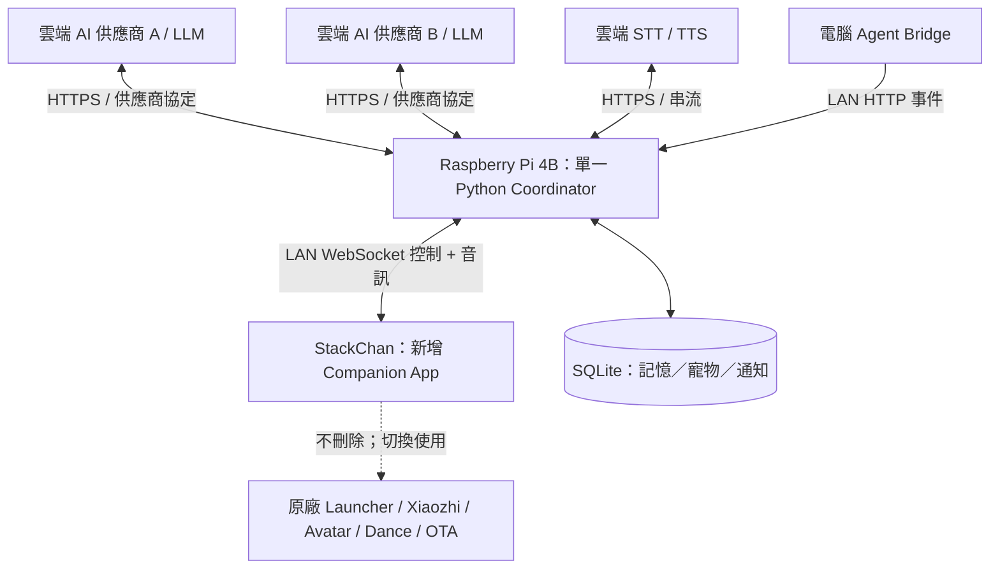
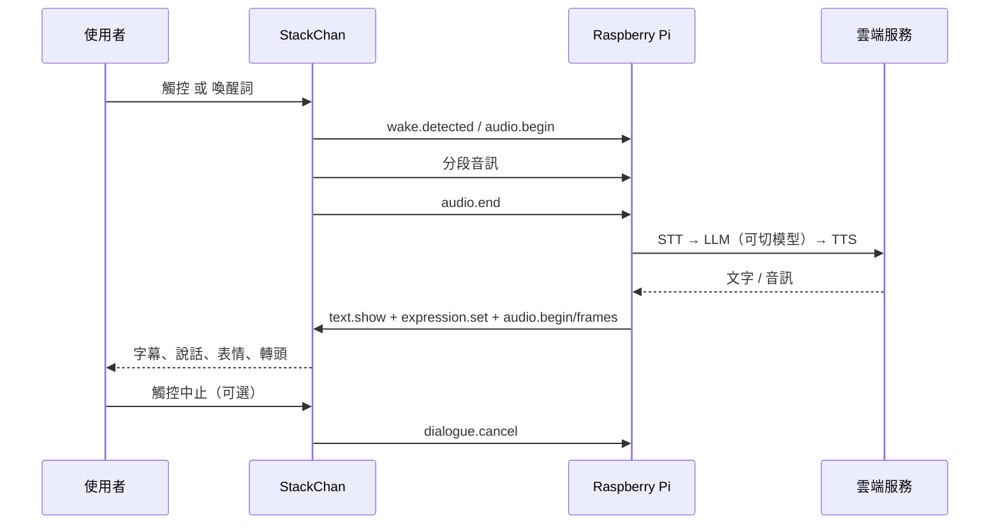

# 01｜系統架構（v2.3.3）

## 1. 系統總圖


## 2. 各部件責任
| 項目 | Pi Coordinator | StackChan |
|---|---|---|
| 雲端 LLM 多模型選擇、STT、TTS | 控制與 API 呼叫 | 不保存金鑰；收音、播音 |
| 寵物自主活動、情緒、記憶 | AI 選擇意圖，狀態存 SQLite | 以白名單動畫／表情本機執行 |
| 喚醒詞 | 優先在 Pi 運行輕量偵測（依測試調整） | 麥克風擷取、必要時低負載串流 |
| 觸控起問、觸控中止 | 接收事件、取消雲端工作 | 立即停止播音並通知 Pi |
| 字幕、表情、轉頭 | 送指令（不送逐幀畫面） | LVGL 本機更新；安全馬達限位 |
| Agent 通知 | 全模式可接收與記錄 | **只在 Companion 開啟時顯示／播報** |
| 原廠 Xiaozhi | 不介入 | 使用原廠既有流程 |

## 3. 啟動模式與退出策略
- 設定值 `boot_mode=companion|launcher` 存在**普通 NVS**，預設提供 Companion 主要模式，讓使用者可選擇恢復原廠 Launcher；開發初期可先保留 Launcher 為保護預設，待驗收再啟用 Companion 預設。
- 正常開機時，先初始化 HAL 和 Launcher；若設為 `companion` 且無失敗標記，直接打開 Companion App。
- Companion 可隨時透過退出鍵返回原廠 Launcher；切換前確保麥克風、喇叭、馬達、LVGL/Socket 資源釋放。
- 原廠 AI 路徑保持不變：`AppAiAgent::onOpen()` 請求啟動 Xiaozhi，`main.cpp` 結束 Mooncake 並啟動 Xiaozhi。不能假定原廠 AI 能不用重啟就切回 Companion；實測確認。
- 若 Companion 連續啟動失敗，啟動退回 Launcher，且**不能因 Pi 斷線反覆重啟**。失敗保護僅依裝置本機問題觸發，網路離線不算啟動失敗。

## 4. 兩種喚醒與語音流程

- **MVP 兩種喚醒必須都能用**。先評估 ESP32-S3 上的低負載喚醒詞可行性；不合適則使用設備到 Pi 的低流量音訊串流＋Pi 本地喚醒引擎。若模型/語言不支援，需明確報告，不可偷偷移除喚醒詞需求。
- 播放 TTS 時 MVP 先停用喚醒詞觸發以防自我喚醒，保留觸控即時中斷；語音打斷列 P1。
- 問答運作主流程先半雙工，優先讓第一段語音盡快播放；不綁單一廠商專有協定。

## 5. 寵物 AI 自主行為（核心設計）
- Pi 低頻向選定 LLM 請求一個**受約束的下一步行為意圖**，不是每一幀詢問 AI。觸發條件：完成動畫、情緒變化、使用者互動、事件、低頻排程。
- LLM 可從 `sleep / read / work / eat / walk / look_around / idle / celebrate` 選擇，附簡短理由、表情和可選一句話。
- Pi 驗證 action 類型、重複頻率、最大長度、是否安靜時段；StackChan 再驗證馬達限位。AI **不能直接產生任意馬達角度或執行系統指令**。
- 非 AI 規則**只作離線/超時/預算限制備援**；雲端可用時，日常主要選擇權屬於 AI。
- StackChan 本地自主播放已快取動畫；若 Pi 超時，先完成目前動畫並安全轉回待機，不會卡住。

## 6. 事件與資源仲裁
- 在 Companion 內：`SAFETY/STOP > TOUCH / USER_DIALOGUE > AGENT_NOTIFICATION > PET_AUTONOMY`。
- `LISTENING/THINKING/SPEAKING` 期間通知排隊；退出 Companion 時**不顯示任何通知**，Pi 仍可記錄，回到 Companion 時僅顯示未過期摘要。
- 原廠 Xiaozhi 使用時 Companion 不占用音訊／UI／馬達，不做背景覆蓋。Pi 端事件仍可寫入 SQLite。

## 7. 效能與部署原則
- Pi 只有一個 Python 協調服務（FastAPI/asyncio + SQLite + systemd），不引入 Docker、Redis 或企業消息中介層。
- LLM 與 TTS 非阻塞；AI 自主行為有最小間隔、取消舊請求與費用上限，避免多次重複請求。
- Pi 不發每幀動畫，StackChan 本地渲染；二進位音訊走有界緩衝，控制封包與音訊封包分離。
- Pi 使用第一張 128GB microSD；StackChan 不依賴第二張卡。

## StackChan microSD 狀態功能的責任歸屬
- SD 狀態查詢屬於 **StackChan 本機 HAL + 原廠 Setup App UI**，不經 Raspberry Pi，也不佔用 AI/Agent 通訊協定。
- Raspberry Pi 第一張 128GB 的可用空間，與 StackChan 第二張 microSD 插槽資訊是兩個不同資源，絕不可混用或誤標。
- 此功能採 `UI → SdCardStatusWorker → storage HAL → SDSPI/FATFS`，資料查詢不阻塞 LVGL 更新。
- 無卡、未知檔案系統或掛載失敗時只顯示狀態，不影響原廠 AI 或 Companion 啟動。

## v2.3.3 行為與打擾治理（補充架構）
```text
Cloud LLM A / B
    ↓ 高階活動候選（非硬體命令）
Raspberry Pi 4B / Python Coordinator
    ├─ Provider Router / STT / TTS / Voice Session
    ├─ Pet Planner（情緒、精力、記憶、五類興趣）
    ├─ Proactivity Gate（安靜時段、專注模式、發言上限）
    ├─ Activity Controller（使用者 > Agent > 日常活動）
    ├─ SQLite（興趣／狀態／記憶／事件）
    └─ Device WebSocket / Event API
              ↓ 合法指令（允許清單、過期時間、會話）
StackChan Companion Mooncake App
    ├─ Audio input/output / UI / touch / animation / servo guard
    └─ Pi 離線時本機待機（不執行雲端決策）

原廠 AppLauncher / AppAiAgent / Setup / OTA ... 保留
  ※ Xiaozhi 啟動後卸載 Mooncake Apps 並接管主流程，
     第一版允許以既有 warm reboot 返回 Launcher，禁止假設同時運作。
```

### 互動管制分界
- **LLM 可選**活動、情緒、短語、持續時間，不可直接輸出 GPIO/Servo/檔案操作/設備 OTA。
- **Pi 驗證**活動白名單、主動發言額度、模型輸出欄位、有效期限、對話/通知優先序；限制每日自主 LLM 次數與可估算費用。
- **StackChan 再驗證**動畫是否存在、字串大小、馬達速度/角度、停止按鍵永遠可用。
- **當不在 Companion 模式**：Pi 保存必要事件但不推動畫／語音／字幕通知；無活動會話或斷線一律視為「不可推送」。
- **興趣管理只在 Pi**：StackChan 不必有 microSD；設定頁查詢的是 StackChan 本體卡槽，與 Pi 的 128GB 系統卡分開。
