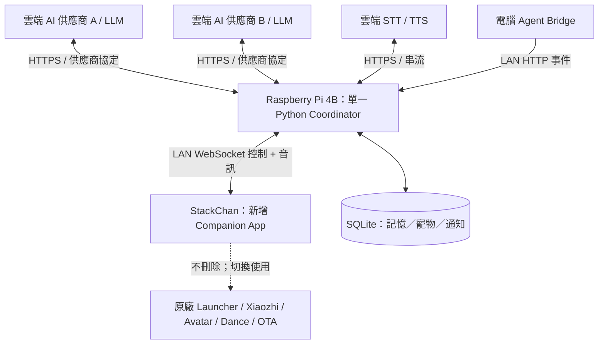
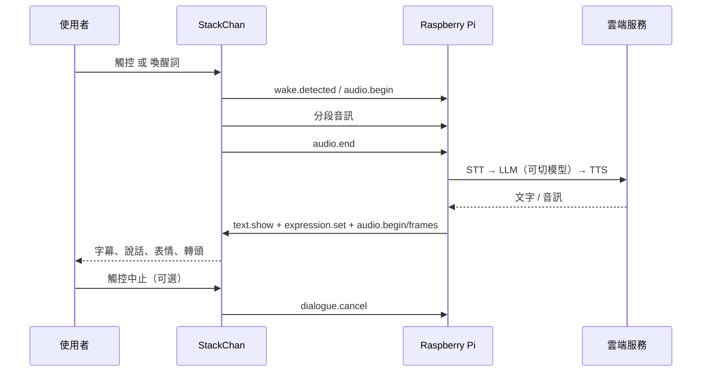

# StackChan Companion v2.3.3 — 完整開發規格書

> 更新日期：2026-11-20｜狀態：設計定稿、尚未實作。
> 開發基線：`jason22432150/StackChan` / `my-stackchan-01`，已核對 SHA `4a39d5114c5d8ea555444396434918db6a0f5656`。

本文件整合 18 份獨立 Markdown，建議給 Codex 時**以 ZIP 中可逐檔閱讀的版本為準**。

---


---

# StackChan Companion v2.3.3 — 開發文件總覽

> 日期：2026-11-20｜狀態：需求定稿／尚未實作｜用途：供 Codex 或工程師直接依規格分階段開發。

## 專案目標
保留現有 `jason22432150/StackChan` 分支 `my-stackchan-01` 的原廠 Xiaozhi、Launcher、Avatar、Dance、Setup、OTA；**新增 Companion App 入口**。Raspberry Pi 4B 作為 AI 大腦，經雲端模型提供 STT/LLM/TTS、長期偏好記憶、寵物自主行為與 Agent 事件整合；StackChan 收音、播放、顯示文字／表情／動畫、觸控與轉頭。

## 8 項已確認使用者決策（v2.3 變更基準）
1. **多模型切換**：Pi 可從設定切換至少兩個雲端 LLM 提供者／模型；STT/TTS 可先用各一種服務，介面保留替換空間。
2. **觸控＋喚醒詞都能開始對話**：兩種入口同等重要，納入 MVP；喚醒詞為可設定值，偵測位置由實測決定。
3. **先觸控打斷 AI 說話**：語音打斷與全雙工留到後續版本。
4. **Companion 為主要模式**：正常開機可預設進 Companion，原廠主選單和 Xiaozhi 仍能切回；故障安全退回 Launcher。
5. **Agent 通知只在 Companion 模式顯示／播報**：退出 Companion 後絕不可覆蓋原廠 App；Pi 可儲存事件，重新進入時顯示合理摘要。
6. **AI 自主決定大部分寵物活動**：Pi 使用雲端 LLM 選擇活動、表情、短句等；只允許安全白名單動作，離線時本機規則維持運作。
7. **長期記憶**：保存使用者偏好、寵物關係與重要事件；預設不長期儲存原始錄音或所有對話全文。
8. **直接安裝 Python 服務**：Raspberry Pi OS 上單一 Python Coordinator + systemd + SQLite；不強制 Docker。

## 不可違反原則
- 個人使用、功能完整、流暢優先；拒絕企業級微服務、Kubernetes、Redis、多租戶 IAM 等非必要複雜度。
- 原廠功能**不刪除不替代**；Companion 是新增 App，雙方同時間只由一個模式掌控音訊、UI、馬達。
- **禁止新增任何 eFuse 寫入**，包括自動燒入 Secure Boot／Flash Encryption eFuse。
- Pi 使用第一張 **128GB microSD**；第二張 **128GB 暫留**，StackChan 暫不依賴 SD 卡。
- 雲端 API key 留在 Pi，絕不放入 StackChan 韌體或 Git；雲端 API 費用不等於 ChatGPT Plus 費用。

## 版本與來源基線
- Repository：https://github.com/jason22432150/StackChan
- 主要分支：`my-stackchan-01`
- 已確認 commit：`4a39d5114c5d8ea555444396434918db6a0f5656`；**開發前重查 HEAD**。
- 建議開發分支：`feature/stackchan-companion`（尚未建立）。
- 技術基礎：ESP-IDF v6.1、Mooncake、LVGL、ESP32-S3、Raspberry Pi 4B、Python asyncio/FastAPI。

## 文件清單
| 檔案 | 目的 |
|---|---|
| `00_README.md` | 總覽與不可變需求 |
| `01_ARCHITECTURE.md` | 全系統架構、啟動、資源控制、離線策略 |
| `02_MVP_SCOPE.md` | MVP P0 必要功能與可驗收標準 |
| `03_PROTOCOL.md` | Pi↔StackChan 控制／音訊協定 |
| `04_FIRMWARE_INTEGRATION.md` | 對原廠程式碼的精確整合位置 |
| `05_PI_SERVICES_AND_PET.md` | 多模型、AI 自主、記憶、通知、儲存 |
| `06_DEVELOPMENT_PLAN.md` | 可依序實作與測試的階段 |
| `07_TEST_SAFETY.md` | 效能、品質、安全與回退 |
| `08_AI_IMPLEMENTATION_PROMPT.md` | 可貼給 Codex 的工作指令 |
| `09_SOURCES_AND_ASSUMPTIONS.md` | GitHub 證據與待查事項 |
| `10_DECISIONS_v2.3.md` | 8 項決策與舊版差異 |

## 狀態說明
「已確認」表示確認源碼存在基礎，不代表完成實機驗證；「設計」表示開發目標。**目前尚未修改 GitHub，未燒錄或測試硬體。**

## v2.3.1 新增：StackChan microSD 設定頁
- 在 StackChan **原廠 SETUP → Device → Storage / microSD** 新增獨立儲存資訊頁（不依賴 Pi 連線）。
- 顯示 microSD 掛載狀態、總容量、剩餘容量、已用容量、使用率；支援重新檢查與安全的錯誤畫面。
- **唯讀診斷**，禁止自動格式化與寫入測試；CoreS3 官方規格為最大 16GB，兩張 128GB 卡不可宣稱已相容。
- 這是可單獨驗收的小型 MVP 功能，**不影響核心 Companion AI／寵物／通知系統、不強制插卡**。
- 具體規格見 `11_SD_STATUS_SETTINGS.md`。

## v2.3.2 → v2.3.3 最新定案（開發優先遵循）
- **自然寵物型**：寵物平常經常安靜活動，偶有文字泡泡，低頻主動說話；不追問、不要求使用者回覆。
- **AI 主導高階活動**：雲端模型決定大部分「要做什麼」，而不是逐幀操作；本機動畫／受控動作仍在 StackChan 執行。
- **寵物興趣系統**：`閱讀、研究與工作、美食、探索、藝術與創作` 五類興趣，0–100 偏好、漸進變化、防重複與記憶持久化。
- **安靜保護**：預設安靜時段 23:00–08:00（可調）、手動專注模式、原廠模式完全不受 Companion 打擾。
- **主動語音建議初始限制**：每日最多 3 次、兩次至少間隔 90 分鐘；為可修改預設值，並非經實機測試得到的最佳參數。
- **MVP 新增 MVP-19/20**：興趣演化與自然寵物的低打擾主動互動，見 `02_MVP_SCOPE.md`。
- **新文件**：`12_PET_INTERESTS.md`、`13_PROACTIVE_INTERACTION.md`、`14_RISKS_SPIKES.md`、`15_DATA_CONFIG.md`、`16_IMPLEMENTATION_BACKLOG.md`、`17_DEPLOYMENT_RUNBOOK.md`。

**請以本包 v2.3.3 內容為準。** 此文件包是設計規格，不代表已修改 GitHub、燒錄裝置或完成實機測試。

## 快速開始：交給 AI 開發
1. 將本包的 `.md` 檔案放入 Repository 的 `docs/companion/`（只新增文件，不覆蓋原廠功能）。
2. 請 Codex 先閱讀 `00_README.md`、`10_DECISIONS_v2.3.md`、`02_MVP_SCOPE.md`、`14_RISKS_SPIKES.md` 與 `08_AI_IMPLEMENTATION_PROMPT.md`。
3. 開發從 Phase 0 開始，**每階段先提交程式碼、測試、回退說明，再進下一階段**。不要一次做完全部功能，不自動燒錄。
4. 以基礎分支 `my-stackchan-01` 的已核對提交 `4a39d5114c5d8ea555444396434918db6a0f5656` 為**文件核對基線**；開始開發時再次檢查實際 HEAD，若不同需評估差異，不可強制回退使用者的更新。

## v2.3.3 文件索引與建議閱讀順序
- [`00_README.md`](./00_README.md)
- [`01_ARCHITECTURE.md`](./01_ARCHITECTURE.md)
- [`02_MVP_SCOPE.md`](./02_MVP_SCOPE.md)
- [`03_PROTOCOL.md`](./03_PROTOCOL.md)
- [`04_FIRMWARE_INTEGRATION.md`](./04_FIRMWARE_INTEGRATION.md)
- [`05_PI_SERVICES_AND_PET.md`](./05_PI_SERVICES_AND_PET.md)
- [`06_DEVELOPMENT_PLAN.md`](./06_DEVELOPMENT_PLAN.md)
- [`07_TEST_SAFETY.md`](./07_TEST_SAFETY.md)
- [`08_AI_IMPLEMENTATION_PROMPT.md`](./08_AI_IMPLEMENTATION_PROMPT.md)
- [`09_SOURCES_AND_ASSUMPTIONS.md`](./09_SOURCES_AND_ASSUMPTIONS.md)
- [`10_DECISIONS_v2.3.md`](./10_DECISIONS_v2.3.md)
- [`11_SD_STATUS_SETTINGS.md`](./11_SD_STATUS_SETTINGS.md)
- [`12_PET_INTERESTS.md`](./12_PET_INTERESTS.md)
- [`13_PROACTIVE_INTERACTION.md`](./13_PROACTIVE_INTERACTION.md)
- [`14_RISKS_SPIKES.md`](./14_RISKS_SPIKES.md)
- [`15_DATA_CONFIG.md`](./15_DATA_CONFIG.md)
- [`16_IMPLEMENTATION_BACKLOG.md`](./16_IMPLEMENTATION_BACKLOG.md)
- [`17_DEPLOYMENT_RUNBOOK.md`](./17_DEPLOYMENT_RUNBOOK.md)


---

# 01｜系統架構（v2.3.3）

## 1. 系統總圖


## 2. 各部件責任
| 項目 | Pi Coordinator | StackChan |
|---|---|---|
| 雲端 LLM 多模型選擇、STT、TTS | 控制與 API 呼叫 | 不保存金鑰；收音、播音 |
| 寵物自主活動、情緒、記憶 | AI 選擇意圖，狀態存 SQLite | 以白名單動畫／表情本機執行 |
| 喚醒詞 | 優先在 Pi 運行輕量偵測（依測試調整） | 麥克風擷取、必要時低負載串流 |
| 觸控起問、觸控中止 | 接收事件、取消雲端工作 | 立即停止播音並通知 Pi |
| 字幕、表情、轉頭 | 送指令（不送逐幀畫面） | LVGL 本機更新；安全馬達限位 |
| Agent 通知 | 全模式可接收與記錄 | **只在 Companion 開啟時顯示／播報** |
| 原廠 Xiaozhi | 不介入 | 使用原廠既有流程 |

## 3. 啟動模式與退出策略
- 設定值 `boot_mode=companion|launcher` 存在**普通 NVS**，預設提供 Companion 主要模式，讓使用者可選擇恢復原廠 Launcher；開發初期可先保留 Launcher 為保護預設，待驗收再啟用 Companion 預設。
- 正常開機時，先初始化 HAL 和 Launcher；若設為 `companion` 且無失敗標記，直接打開 Companion App。
- Companion 可隨時透過退出鍵返回原廠 Launcher；切換前確保麥克風、喇叭、馬達、LVGL/Socket 資源釋放。
- 原廠 AI 路徑保持不變：`AppAiAgent::onOpen()` 請求啟動 Xiaozhi，`main.cpp` 結束 Mooncake 並啟動 Xiaozhi。不能假定原廠 AI 能不用重啟就切回 Companion；實測確認。
- 若 Companion 連續啟動失敗，啟動退回 Launcher，且**不能因 Pi 斷線反覆重啟**。失敗保護僅依裝置本機問題觸發，網路離線不算啟動失敗。

## 4. 兩種喚醒與語音流程

- **MVP 兩種喚醒必須都能用**。先評估 ESP32-S3 上的低負載喚醒詞可行性；不合適則使用設備到 Pi 的低流量音訊串流＋Pi 本地喚醒引擎。若模型/語言不支援，需明確報告，不可偷偷移除喚醒詞需求。
- 播放 TTS 時 MVP 先停用喚醒詞觸發以防自我喚醒，保留觸控即時中斷；語音打斷列 P1。
- 問答運作主流程先半雙工，優先讓第一段語音盡快播放；不綁單一廠商專有協定。

## 5. 寵物 AI 自主行為（核心設計）
- Pi 低頻向選定 LLM 請求一個**受約束的下一步行為意圖**，不是每一幀詢問 AI。觸發條件：完成動畫、情緒變化、使用者互動、事件、低頻排程。
- LLM 可從 `sleep / read / work / eat / walk / look_around / idle / celebrate` 選擇，附簡短理由、表情和可選一句話。
- Pi 驗證 action 類型、重複頻率、最大長度、是否安靜時段；StackChan 再驗證馬達限位。AI **不能直接產生任意馬達角度或執行系統指令**。
- 非 AI 規則**只作離線/超時/預算限制備援**；雲端可用時，日常主要選擇權屬於 AI。
- StackChan 本地自主播放已快取動畫；若 Pi 超時，先完成目前動畫並安全轉回待機，不會卡住。

## 6. 事件與資源仲裁
- 在 Companion 內：`SAFETY/STOP > TOUCH / USER_DIALOGUE > AGENT_NOTIFICATION > PET_AUTONOMY`。
- `LISTENING/THINKING/SPEAKING` 期間通知排隊；退出 Companion 時**不顯示任何通知**，Pi 仍可記錄，回到 Companion 時僅顯示未過期摘要。
- 原廠 Xiaozhi 使用時 Companion 不占用音訊／UI／馬達，不做背景覆蓋。Pi 端事件仍可寫入 SQLite。

## 7. 效能與部署原則
- Pi 只有一個 Python 協調服務（FastAPI/asyncio + SQLite + systemd），不引入 Docker、Redis 或企業消息中介層。
- LLM 與 TTS 非阻塞；AI 自主行為有最小間隔、取消舊請求與費用上限，避免多次重複請求。
- Pi 不發每幀動畫，StackChan 本地渲染；二進位音訊走有界緩衝，控制封包與音訊封包分離。
- Pi 使用第一張 128GB microSD；StackChan 不依賴第二張卡。

## StackChan microSD 狀態功能的責任歸屬
- SD 狀態查詢屬於 **StackChan 本機 HAL + 原廠 Setup App UI**，不經 Raspberry Pi，也不佔用 AI/Agent 通訊協定。
- Raspberry Pi 第一張 128GB 的可用空間，與 StackChan 第二張 microSD 插槽資訊是兩個不同資源，絕不可混用或誤標。
- 此功能採 `UI → SdCardStatusWorker → storage HAL → SDSPI/FATFS`，資料查詢不阻塞 LVGL 更新。
- 無卡、未知檔案系統或掛載失敗時只顯示狀態，不影響原廠 AI 或 Companion 啟動。

## v2.3.3 行為與打擾治理（補充架構）
```text
Cloud LLM A / B
    ↓ 高階活動候選（非硬體命令）
Raspberry Pi 4B / Python Coordinator
    ├─ Provider Router / STT / TTS / Voice Session
    ├─ Pet Planner（情緒、精力、記憶、五類興趣）
    ├─ Proactivity Gate（安靜時段、專注模式、發言上限）
    ├─ Activity Controller（使用者 > Agent > 日常活動）
    ├─ SQLite（興趣／狀態／記憶／事件）
    └─ Device WebSocket / Event API
              ↓ 合法指令（允許清單、過期時間、會話）
StackChan Companion Mooncake App
    ├─ Audio input/output / UI / touch / animation / servo guard
    └─ Pi 離線時本機待機（不執行雲端決策）

原廠 AppLauncher / AppAiAgent / Setup / OTA ... 保留
  ※ Xiaozhi 啟動後卸載 Mooncake Apps 並接管主流程，
     第一版允許以既有 warm reboot 返回 Launcher，禁止假設同時運作。
```

### 互動管制分界
- **LLM 可選**活動、情緒、短語、持續時間，不可直接輸出 GPIO/Servo/檔案操作/設備 OTA。
- **Pi 驗證**活動白名單、主動發言額度、模型輸出欄位、有效期限、對話/通知優先序；限制每日自主 LLM 次數與可估算費用。
- **StackChan 再驗證**動畫是否存在、字串大小、馬達速度/角度、停止按鍵永遠可用。
- **當不在 Companion 模式**：Pi 保存必要事件但不推動畫／語音／字幕通知；無活動會話或斷線一律視為「不可推送」。
- **興趣管理只在 Pi**：StackChan 不必有 microSD；設定頁查詢的是 StackChan 本體卡槽，與 Pi 的 128GB 系統卡分開。


---

# 02｜MVP v2.3.3 範圍與驗收規格

## MVP 定義
**從 Companion 作為主要模式啟動，使用觸控或喚醒詞與 Pi 串接的雲端 AI 對話；Pi 可切換至少兩個雲端模型；Pi 的 AI 決定多數寵物活動並記住使用者偏好；StackChan 能說話、顯示字幕／表情、轉頭；原廠 AI 仍可切回。**

## P0：本版 MVP 必須交付
| ID | 必要功能 | 實測驗收標準 |
|---|---|---|
| MVP-01 | 新增 Companion App | Launcher 可開啟／退出，原廠 AI/Avatar/Dance/Setup/OTA 入口保留 |
| MVP-02 | Companion 優先啟動 | 設定 `boot_mode=companion` 後開機自動進入；能改回 Launcher；App 啟動異常可安全回退 |
| MVP-03 | Pi 單一 Python 服務 | Raspberry Pi OS 以 systemd 啟動；重開 Pi 後服務可恢復，不需 Docker |
| MVP-04 | LAN 連線及配對 | 配對後可自動重連；連續 30 分鐘無崩潰；Pi 離線顯示離線而非重開機循環 |
| MVP-05 | 雲端多模型切換 | 至少兩個真正的 LLM Provider Adapter，設定切換，不需重刷 StackChan；需用使用者提供的有效金鑰才能驗收實際雲端呼叫 |
| MVP-06 | 觸控發起對話 | 使用者觸控可啟動一次錄音和問答；狀態正確變更 |
| MVP-07 | 喚醒詞發起對話 | 指定喚醒詞在安靜環境重複測試 10 次，目標 ≥ 8 次正確啟動；實測誤觸發並記錄，未達標不得聲稱完成 |
| MVP-08 | 收音 → STT | StackChan 音訊經 Pi 送 STT，繁體中文句子能辨識；無長期原音保存 |
| MVP-09 | 雲端 LLM 問答 | 兩個 Provider 均可完成至少一輪中文問答；失敗時可顯示錯誤、回到待機 |
| MVP-10 | TTS 播放與字幕 | Pi 送回語音和文字；StackChan 可播報、顯示字幕和 Speaking 表情 |
| MVP-11 | 觸控打斷 | 語音播放中觸控，當下停止本地音訊、取消 Pi 當次輸出，不卡 UI；後續語音打斷非本版必須 |
| MVP-12 | 表情、動作與動畫 | 提供基本表情與至少 `idle/sleep/read/work/eat/walk` 動畫或可辨識的輕量替代表現；頭部動作有安全限位 |
| MVP-13 | AI 主導寵物活動 | 線上時下一步日常活動由 LLM 選擇，會參照心情/精力/時段；AI 超時時本地規則備援；不可用高頻率 API 呼叫模擬逐幀動畫 |
| MVP-14 | 寵物狀態與長期記憶 | Pi SQLite 保存偏好、寵物親密度／狀態、重要事件；重開機能恢復；可以清除或修改記憶 |
| MVP-15 | 模式間資源釋放 | 關閉 Companion 後原廠 Xiaozhi 能依其既有流程使用麥克風、喇叭與馬達，不需要刪改原廠 AI |
| MVP-16 | 安全與保護 | 禁止新增 eFuse 寫入、雲端金鑰僅 Pi 保存、裝置指令白名單和限位；未知封包不造成死機 |
| MVP-17 | 事件通知模式隔離 | 即使 Pi 收到事件，離開 Companion 之後 StackChan **不得在原廠畫面彈出/播報通知**；重回 Companion 時允許顯示未讀摘要 |

**解讀：** Agent Bridge 完整串接可列為 P1，但即使未完成，MVP 的「模式隔離」機制及簡單的模擬事件測試必須先存在，避免後期破壞原廠模式。

## P1：MVP 通過後優先擴充
1. Codex 原生事件 Bridge、成功／失敗／需注意通知及去重；僅 Companion 顯示／播報，對話期間排隊。
2. 其他 Agent 來源（Cursor／ChatGPT／Grok）逐個評估可靠事件接口，不偽造任務成功。
3. AI 直接追問 Agent 任務摘要、更多個性化活動素材、寵物自發簡短語音。
4. 完善分段 TTS/增量字幕、簡易網頁管理頁、Pi 一鍵更新與可恢復的回退。
5. 語音打斷（需額外回聲消除／全雙工設計）、更靈敏喚醒詞及多個可設定詞。

## P2：後續自由擴充
- 更複雜的多模態輸入、攝影機、語音表情細節、進階記憶檢索。
- 第二張 128GB microSD 的 StackChan 相容性測試；非專案依賴。

## 代表性驗收情境
1. **開機：** 開機直接進 Companion，Pi 網路不在時仍可用離線待機與手動返回原廠 Launcher。
2. **觸控：** 摸/點啟動收音→送 Pi→雲端 LLM→回文字/語音/表情/轉頭。
3. **喚醒：** 不觸控，只說可設定喚醒詞即可啟動收音；TTS 播放時不被自己說話再次喚醒。
4. **改模型：** 在 Pi 設定切至第二個 LLM，再與 StackChan 對話，**無需重新燒錄韌體**。
5. **自主：** 無人互動時，AI 會選擇閱讀、睡覺、工作等行為，且不會一直轉頭或無限制請求雲端 API。
6. **記憶：** 告知偏好並確認保存；隔天重啟 Pi 後仍能依偏好回應。
7. **打斷：** AI 播音途中觸控，立即終止播報並回待命。
8. **原廠：** 退出 Companion → 開原廠 AI，原有功能維持；此時 Agent 事件只被 Pi 記錄，不干擾原廠畫面。

## 非目標與邊界
- Pi 4B 不在本版訓練大型本機模型；主要使用雲端模型。
- ChatGPT Plus 訂閱不自動包含 API 額度；模型服務可能產生費用。
- AI 活動**需要合理節流**；不允許任意操作 OS、網路指令或馬達無限制自由度。
- 文件中的正確率、延遲目標皆待實機驗證，不是目前已有數據。

## v2.3.1 MVP 補充：microSD 設定頁
| MVP-18 | StackChan 設定頁 microSD 狀態 | `SETUP → Device → Storage / microSD` 可顯示掛載狀態與可取得的總/已用/剩餘容量；無卡、不支援或 128GB 無法辨識都不會卡頓、重啟或觸發格式化；不需 Pi 上線即可操作。 |

**交付解讀：** MVP-18 是獨立的唯讀診斷功能；如果 128GB 超出官方相容容量或因 FATFS 限制無法掛載，正確的「掛載失敗」畫面也屬於該卡的合理測試結果，不能把「必須讀到 128GB」當成驗收前提。具體測試見 `11_SD_STATUS_SETTINGS.md`。

## v2.3.3 新增 P0 驗收（自然互動／興趣）
| ID | 功能 | MVP 必須通過的驗收 |
|---|---|---|
| MVP-19 | 寵物興趣系統 | 五項 0–100 興趣能初始化、儲存、逐步成長或回歸；重啟 Pi 不遺失；選擇活動會考慮興趣但不被最高分獨佔；可在無雲端時以規則運作。 |
| MVP-20 | 自然寵物型／低打擾主動互動 | 閒置時有安靜動畫與偶爾文字泡泡；主動語音受每日次數／最小間隔／安靜時段／專注模式約束；使用者不回答不追問；對話、原廠模式不主動說話。 |

**MVP 範圍確認**：MVP-A 做音訊、通訊與 App；MVP-B 做雲端模型／雙喚醒／觸控中止／記憶與興趣資料；MVP-C 做自主興趣活動／低打擾互動／開機模式／設定頁 SD 卡診斷。完整 Agent 原生事件 Bridges 屬 P1，但事件 API 和模式隔離留在 MVP。

### MVP-19/20 量化測試（示例）
1. 使用固定隨機種子／假 LLM 跑 100 次寵物活動選擇，不能連續長期只出現單一活動；允許在精力低時偏向睡眠。
2. 對 `閱讀` 興趣重複給予有效互動，分數逐步增加且不超過 100；一次事件不應暴漲到滿分。
3. 模擬 23:30、專注模式、正在 TTS、原廠模式，主動語音一律被拒絕；使用者觸控問答仍可啟動。
4. 模擬連續 24 小時排程：主動語音不超出可設定每日上限；對未回覆的招呼不安排追問。
5. 雲端模型失敗、Pi 斷線與重啟時，寵物狀態與興趣可恢復，本機動畫不阻塞。

**重要區別：** 自主 AI 的大部分活動由雲端 LLM 決定，但「不打擾」的權限及硬體安全永遠由本地規則優先，不能被 LLM 覆寫。


---

# 03｜Companion 通訊協定草案 v1.1

> 此協定為**新設計**，不是原廠 Avatar WebSocket 的直接相容宣告。開發時先讓 ESP32-S3 與 Pi 兩端對齊，再以實機測試修訂。

## 1. 通道及連線
- StackChan 主動連至 Pi `ws://<pi-ip>:8765/ws/device`，僅允許已配對裝置／LAN 連入；不得將服務 Port Forward 到網際網路。
- Pi `POST /api/events` 接收電腦 Bridge 事件（使用獨立 Token）；無論模式均可紀錄，但**只有 Companion 開啟時能送通知顯示/播報**。
- 內網 `/health` 僅讀健康狀態；`/api/config` 等變更設定的 API 必須驗證。
- 一條 WebSocket 同時傳 JSON 控制與二進位音訊影格；不允許控制 callback 直接阻塞渲染。

## 2. 控制訊息
```json
{"v":1,"id":"msg-00018","type":"animation.play","ts_ms":1795000000000,"payload":{"name":"reading","duration_ms":10000}}
```
- `v` 版本；`id` 去重／回覆；`type` 指令種類；`ts_ms` 可選；`payload` 必填。
- 重要控制指令回 `ack`。未知類型僅回錯，不崩潰；所有字串長度、數值、音訊封包都需設上限。

## 3. 核心事件與方向
| 方向 | type | 主要 payload |
|---|---|---|
| SC→Pi | `hello` | `device_id`, `firmware_version`, `caps`, `mode=companion` |
| Pi→SC | `hello.ok` | `session_id`, `protocol_version`, `settings` |
| 雙向 | `heartbeat` | `uptime_ms`, `state` |
| SC→Pi | `interaction.touch` | `zone`, `action` |
| SC→Pi | `wake.detected` | `source=touch|keyword`, `keyword_id`（如有） |
| 雙向 | `audio.begin` / `audio.end` | `stream_id`, `codec`, `sample_rate`, `channels`, `reason` |
| SC→Pi | `dialogue.cancel` | `turn_id`, `reason=touch` |
| Pi→SC | `text.show` | `text`, `partial`, `turn_id` |
| Pi→SC | `expression.set` | `name`, `duration_ms` |
| Pi→SC | `motion.set` | `yaw_deg`, `pitch_deg`, `speed` |
| Pi→SC | `animation.play` | `name`, `duration_ms`, `loop` |
| Pi→SC | `state.set` | `IDLE/LISTENING/THINKING/SPEAKING/NOTIFYING/OFFLINE` |
| Pi→SC | `pet.state` | `mood`, `energy`, `affinity`, `activity`, `action` |
| SC→Pi | `device.mode` | `mode=companion|launcher|factory_ai`, `active` |
| SC→Pi | `playback.done` | `turn_id`, `stream_id` |
| 雙向 | `stop` / `ack` | `scope`, `reply_to`, `ok` |

### 模式隔離
- Pi 維護 `device_mode`，只有經 `hello` 建立的 **Companion 活動連線** 才能發送通知 UI/音效指令。
- `launcher` 或 `factory_ai` 模式下不推送 `notification.*`、`text.show` 或自行動作來打斷原廠模式；收到 Agent 事件僅在 Pi 儲存。
- 重新連入 Companion 才能要求 `notifications.unread_summary`；摘要需去重、有最大數量與保存時限。

## 4. 二進位音訊影格（設計）
```
Byte 0..3   magic = 'SCA1'
Byte 4      frame version=1
Byte 5      codec_id 1=PCM16_LE / 2=Opus
Byte 6..7   reserved
Byte 8..11  stream_id uint32 BE
Byte 12..15 sequence uint32 BE
Byte 16..  audio payload
```
- 建議 MVP 首先支援 `PCM16_LE 16kHz mono` 上行；下行採裝置能力協商（優先可用 PCM/Opus）。
- `audio.begin` 提供 codec、sample rate、channels；不猜測既有原廠音訊編碼必定互通。
- 語音上行可能有兩種場景：**低負載喚醒偵測**與**真正問答收音**，兩者由不同狀態控制，不能把持續音訊誤當成完整對話。
- 有界音訊佇列、序號檢查、異常丟棄／回錯；預設不將原始錄音長期存檔。
- 觸控取消時，StackChan 先**立即停喇叭**，再傳 `dialogue.cancel`；Pi 停止正在生成或等待的音訊，舊 `turn_id` 回應全部丟棄。

## 5. AI 自主行為訊息
Pi 本地呼叫 LLM，經驗證後才送白名單 `animation.play`、`expression.set`、`text.show`、`motion.set`。**不要將 LLM 任意 JSON 直接作為 StackChan 指令，也不要在網路訊息執行 shell 指令。**

## 6. 重連、配對與心跳
- 以簡單短時效配對碼換取 Pi/設備一般儲存 Token，不動 eFuse。
- 心跳建議每 5 秒，連續 3 次丟失視為 OFFLINE；作為初始設定，依實測修正。
- 斷線不堆疊音訊影格；Pi 的寵物狀態/重要事件寫 SQLite，重連只同步**最新快照**，不重播過期逐幀指令。
- Pi 模型切換屬 Pi 端 `/api/config`／本機設定，不要求 StackChan 重新燒錄。

## v2.3.3：自主活動與主動互動指令（協定增補）
以下為**提案介面**，需兩端一起實作並版本驗證；不可聲稱與原廠 Avatar 協定即插即用。

Pi → StackChan（活動計畫；含唯一識別與時效）
```json
{"v":1,"id":"cmd-201","type":"pet.activity","payload":{"activity_id":"a-202","action":"read","mood":"curious","duration_s":480,"interruptible":true,"expires_at_ms":1795000060000}}
```

Pi → StackChan（可選，不保證一定要播放）
```json
{"v":1,"id":"cmd-202","type":"pet.proactive","payload":{"kind":"text_bubble","text":"我想再看一頁書。","ttl_ms":9000,"activity_id":"a-202"}}
```

StackChan → Pi（回饋）
```json
{"v":1,"id":"evt-201","type":"pet.activity.completed","payload":{"activity_id":"a-202","reason":"completed"}}
```

### 必須實作的協定規則
- `pet.activity` 僅接受活動白名單 `idle/sleep/read/work/eat/walk/explore/create/look_around/celebrate`；不接受任意命令、檔案路徑或模型下發的馬達角度。
- `pet.proactive` 僅供經 Pi Proactivity Gate 許可的低頻短語；`kind=voice` 必須經音訊會話檢查，文字泡泡逾期不重播。
- 控制與音訊擁有明確 `turn_id`、`stream_id` 或 `activity_id`；過期訊息不執行，取消後遲到的回覆全部丟棄。
- 保留原先 `animation.play` 等低階白名單訊息，兩者不可對同一時段的 UI/馬達並行強制控制，由 Activity Controller 仲裁。
- 設備切回 Launcher 或進入原廠 Xiaozhi 前關閉 Companion WebSocket；**Pi 不得推入任何 Companion 音訊／動畫／通知**。若無明確回報，無 Companion 活躍會話即視為不可推送。
- 先規定大小限制與背壓：文字內容長度、音訊分段大小、單向待處理數量、緩衝延遲要有上限；具體數字在 Phase 1/2 實測後定稿。


---

# 04｜原廠韌體整合計畫（保留舊入口）

## 已確認的源碼基礎
- `firmware/main/main.cpp` 安裝 Mooncake Apps；原廠 AI 觸發後會退出 Mooncake 更新迴圈、卸載 Apps，最後進入 `startXiaozhi()`。
- `firmware/main/apps/app_ai_agent/app_ai_agent.cpp` 的 `onOpen()` 呼叫 `requestXiaozhiStart()`；**本專案不刪除此路徑**。
- `firmware/main/apps/app_template/app_template.cpp` 有 App 生命週期和 `LvglLockGuard` 範例。
- `firmware/main/hal/audio.cpp` 透過 `Board::GetInstance().GetAudioCodec()` 做既有麥克風／喇叭測試路徑。
- `firmware/main/hal/hal_ws_avatar.cpp` 已存在 Opus、文字、馬達的 WebSocket 訊息概念，但它**不是本案現成可用的 Pi 協定**。
- `firmware/main/stackchan/modifiers/idle_motion.h` 有避免馬達正在移動時堆疊操作的範例。
- `firmware/main/CMakeLists.txt` 以 `GLOB_RECURSE apps/*.cpp` 蒐集源碼，新增 `.cpp` 通常被涵蓋，但需檢查 build 與新增依賴。

## 新增與最小改動
| 位置 | 工作 |
|---|---|
| `firmware/main/apps/app_companion/` | 新增 App、UI、配對、網路、音訊適配器、可用動畫表 |
| `firmware/main/apps/apps.h` | include 新 App |
| `firmware/main/main.cpp` | 註冊 App，新增安全的 Companion 開機選擇流程；保留原廠 Xiaozhi 啟動路徑 |
| `firmware/main/apps/app_setup/` | 視現有設定框架加開機模式與喚醒詞開關（先以最小改動實作） |
| `firmware/main/stackchan/` | 僅在需要新動畫／表情時擴充；避免大改既有動作核心 |

## Companion App 生命週期
- `onCreate`: 設定 App name、icon、預設狀態。
- `onOpen`: 建 UI、連 Pi、取得 Companion 對麥克風/喇叭的控制權。
- `onRunning`: 處理有界事件佇列，更新文字、表情、動畫；**不可同步等待雲端 API**。
- `onClose`: 即刻停音、停止轉頭、解除喚醒偵測、關閉 socket、釋放 UI/音訊，再交回 Launcher。

## 喚醒與觸控打斷
- **MVP 包含觸控與喚醒詞**。先做音訊能力/CPU/記憶體探測，選「設備端輕量喚醒」或「Pi 端喚醒引擎」；兩條路線均須能在 Companion 閒置模式觸發收音。
- 播音階段不做語音打斷，避免自己的喇叭觸發喚醒；保留觸控取消，播放元件先立即停止，再送取消訊息。
- `onClose` 與 Pi 離線情境都要確保麥克風沒有殘留錄音任務。

## 動畫、字幕、馬達安全
- 本機 LVGL 渲染和動畫執行，不靠 Pi 逐幀傳指令；不可在 socket callback 直接操作 LVGL，透過 `LvglLockGuard`。
- `idle/sleep/read/work/eat/walk` 若無素材，先製作簡單可辨識的 LVGL 動畫/字幕替代，不能宣稱原廠已有相同動畫。
- 用單一馬達 owner 做動作決策；保守角度、速度、冷卻時間；收到 `STOP` 立即停止。**模型只能選已定義動作，不可設定任意硬體參數。**

## Companion 優先／原廠共存
- 啟動選項儲存在一般 NVS：`boot_mode=companion|launcher`；完成可靠開關與失敗退回測試後，使用者可將 Companion 設為預設。
- Pi 離線≠裝置啟動失敗：可顯示離線待機、返回 Launcher，禁止無限重啟。
- 原廠 Xiaozhi 仍由原有 App 啟動；其返回 Launcher 的實際機制需實機驗證，不得假設無縫切換。
- 原廠模式期間**禁止顯示任何 Companion Agent 通知**；只在 Companion App 活動且資源由它持有時可通知。

## 禁止事項
- 禁止刪除原廠 `app_ai_agent`，或把 `main.cpp` 改成唯一的 Companion 主程式。
- 禁止新增任何 eFuse 寫入、Secure Boot/Flash Encryption provisioning、破壞原廠 OTA 分割區。
- 不需要 StackChan microSD；第二張 128GB 暫留。

## 原廠設定新增 Storage / microSD（v2.3.1）
- 已確認 `app_setup/app_setup.cpp` 的 `Device` 分組是新增入口的最低改動位置：增加 `Storage / microSD`，採既有 Worker 選單/返回模式。
- 新增 `workers/storage.cpp`、`SdCardStatusWorker` 與 `hal_storage.cpp` 或同等輕量 storage module，獨立提供狀態、容量查詢。
- 必須檢查 SPI bus 共用方式及 Card Detect 是否存在，不能假設 Arduino 範例直接等於 ESP-IDF 原廠韌體實作。
- UI thread 不做阻塞式 mount / FATFS 容量掃描；使用背景工作結果更新 LVGL。
- 唯讀、`format_if_mount_failed=false`、不新增任何 eFuse 寫入、不得自動修改 SD 內容。詳細見 `11_SD_STATUS_SETTINGS.md`。

## v2.3.3 新增的 StackChan 本機責任
- **新增 Companion App，但不是獨立可安裝 binary**：原廠 Mooncake App 是一起編進韌體的，首次加入需要重新 build/flash；Pi AI 更新不必每次刷機。
- **本地 Activity Executor**：至少可播放 `idle/read/work/eat/sleep/walk/explore/create` 的基本可辨識表現；接受 Pi 高階行為指令後自行管理眨眼、翻頁、輕度動畫，不需要逐幀走網路。
- **Stop 優先**：觸控中止時先停止本機 TTS 輸出，再通知 Pi 取消；即使 Pi 正在斷線仍能停止本機播放。
- **離線模式**：當 Pi 無法連線時顯示狀態並執行有限的本機待機動畫；不假裝雲端 AI 已回答。
- **不打擾**：所有主動文字泡泡和主動語音在切出 Companion 前先取消；原廠 App 不注入 Companion overlay。
- **資源與執行緒安全**：LVGL 更新須依既有 `LvglLockGuard` 慣例；音訊與網路不能阻塞 `onRunning()`；避免重複初始化音訊 Codec 或與原廠爭用。
- **韌體權限**：即便 Pi 送來過界的動作，裝置仍必須限位與拒絕；不得接受 LLM 原文作為硬體指令。

### 已驗證來源及尚未驗證區分
已確認：`main.cpp` 中 Xiaozhi 進入後卸載 Apps；`app_template` 有四種生命週期；`hal/audio.cpp` 有音訊讀寫測試；`hal_ws_avatar.cpp` 含 Opus／文字／動作訊息種類；`app_setup.cpp` 有 Worker 選單。**尚未驗證**：可供 Companion 重用的串流 Opus 流水線、喚醒詞是否可本機常駐、ESP32-S3 可用堆記憶體、連續語音與場景動畫的並行性能。


---

# 05｜Pi AI、寵物自主、長期記憶與通知

## 部署架構
單一 Python 服務，FastAPI + asyncio + SQLite + systemd，使用 Raspberry Pi OS 64-bit；不需 Docker 或企業級服務。

```text
coordinator/
  app/main.py                  # 程式入口與生命週期
  app/config.py                # YAML + env，含 active_llm_provider
  app/device_ws.py             # StackChan WebSocket
  app/audio_pipeline.py        # STT / TTS、音訊緩衝與取消
  app/wake_word.py             # Pi 偵測器（若實機選此路）
  app/providers/base.py        # 小型 LLM Adapter 介面
  app/providers/provider_a.py  # 雲端模型 A
  app/providers/provider_b.py  # 雲端模型 B
  app/assistant.py             # 使用者語音對話與回應
  app/pet.py                   # 角色心情、親密度及活動狀態
  app/pet_planner.py           # LLM 自主行為選擇與白名單驗證
  app/memory.py                # 偏好／重要事件／關係記憶
  app/notifications.py         # Agent 事件與 Companion-only 顯示
  app/storage.py               # SQLite
  app/events_api.py            # 電腦 Bridge HTTP
  config.example.yaml
  data/                        # 不提交 Git
  tests/
```

## 多模型切換（MVP）
- 支援**至少兩個真正的雲端 LLM provider adapter**，介面簡單：`generate_reply(context, user_text)`、`choose_pet_action(context)`，回傳標準化資料。供應商可依實際選擇，例如 OpenAI／Gemini；**不假設使用者已持有任何 API 金鑰**。
- `active_llm_provider` 設定可修改；更換 LLM 只動 Pi，不需要重新燒錄 StackChan；STT/TTS 初期可以各固定一種服務，之後逐步抽換。
- 失敗：顯示錯誤並回 Idle；可選手動換備用提供者，避免隱性跳轉造成未知費用。測試需有假 provider 可無金鑰執行。
- Provider key 只放 Pi 的受限 `.env`/環境變數；不要將對話與金鑰寫入除錯日誌。
- 設定 API 額度/每日預算上限（個人版簡單計數即可），防止自主活動頻繁消耗 token。

## AI 自主行為（MVP）
- 角色狀態：`mood`、`energy`、`affinity`、`activity`，數值 0–100；並有 `current_action`、`quiet_hours`、`last_interaction_at`。
- Pi 在**上一段活動結束、重要事件發生或使用者互動後**，才向 LLM 發起下一步行為建議，另設最小請求間隔（初始建議 60–180 秒，之後量測調整）；不是每幀詢問。
- LLM 只能選：`idle, sleep, read, work, eat, walk, look_around, celebrate` 等預先允許行為；可附 `emotion`、`optional_short_line`、`duration_s`。限制 `duration_s`、語音播報頻率及夜間動作。
- **在線時 AI 決定多數活動**；雲端斷線、超額、timeout 時改用本地低頻規則與現有 `idle_motion` 備援。
- 單一動作 owner；任何輸出都先經 Pi 驗證，再由 StackChan 再次限位。避免突發多個轉頭要求／音訊重疊。

### 模型建議的示例（僅邏輯，不直接傳硬體）
```json
{"action":"read","emotion":"curious","duration_s":45,"optional_short_line":"我來看一下書！"}
```

## 記憶與儲存（MVP）
SQLite 最小表格：
- `pet_state(id,mood,energy,affinity,activity,current_action,updated_at)`：寵物狀態。
- `user_preferences(key,value,updated_at)`：暱稱、安靜時間、個性偏好等使用者明確指定的設定。
- `memories(id,kind,summary,importance,created_at)`：重要事件與關係互動摘要；提供可查看／刪除方式。
- `agent_events(event_id,source,status,title,summary,confidence,created_at,read_at)`：Agent 事件，P1 正式接入。
- 可配置保留天數與最多條數；預設不存原始錄音、完整對話全文，避免過度占用空間與隱私問題。
- AI 讀取相關偏好與近期重要記憶，不讓每次 prompt 無限制成長。重開機後可恢復狀態。

## 通知策略：只有 Companion 模式（P1）
- Windows/macOS/Linux Bridge 使用可靠事件接口優先；原生 hook > 日誌 > UI 推測。UI 推測不能當成確定成功。
- Pi **可在任何模式記錄事件**，但裝置處於 `factory_ai/launcher/other` 時**不發出任何通知顯示／聲音／動作指令**。
- Companion 內，使用者對話時通知排隊；多筆合併摘要；重新進入時只顯示未讀且不過期的通知摘要，避免一次大量播報。
- 使用 `event_id` 去重；成功／失敗與來源可信度分開儲存；重要事件必要時納入寵物記憶。

## 開機與更新
- Pi 在 systemd 中自啟；新的 LLM/寵物規則只改 Python，再重啟該服務，StackChan 自動重連。
- 不做複雜 OTA 平台；Pi 更新先備份 SQLite/config 並保留上一個 Git commit，若服務無法啟動可回退。
- 第一張 128GB microSD 給 Pi；第二張保留。不要將韌體中內嵌的資源誤認為可自動從 StackChan microSD 載入。

## v2.3.3：Pet Interest System + Natural Proactivity
在先前 `app/pet.py`、`app/pet_planner.py` 基礎上，建議新增小型 `app/pet_interests.py` 與 `app/proactivity.py`，**仍為單一 Python 服務**。

**興趣維度：** reading、coding、food、exploration、creative；每項 0–100，初始中性分數，緩慢調整。睡覺不是興趣，而是由 energy 決定的生理狀態。保留活動最近歷史避免同一選項一直勝出。

**AI 選擇：** 先由 Pi 根據心情、精力、時段、偏好、最近活動整理候選，再請 LLM 從可用候選中決定高階行為。LLM 只提交 `{action, emotion, duration_s, optional_short_line}`；程式檢查後才執行。雲端失敗時採用本機加權選擇；避免為眨眼等低階事件消耗 token。

**自然主動互動：** 預設以非語音小動作為主；文字泡泡較少；主動語音極少（初始建議每日≤3、間隔≥90 分鐘）。`quiet_hours`（初始 23:00–08:00）、`focus_mode`、`user_dialogue_active`、`speaking`、`device_mode` 任一限制生效就不得主動播音。主動說完若無回覆，不追問。

**自主與安全取捨**：使用者已選 AI 決定大部分活動，此處指**高階活動選擇**，不是授權 AI 繞過物理馬達限位、佔用音訊或修改設定。模型費用、每日自主決策總次數與 API timeout 需在 Pi 可設定。

**SQLite** 新增 `pet_interests`、`pet_activity_history`、`proactive_log` 三表，保持簡單索引與有限事件保留。完整欄位與設定範例見 `15_DATA_CONFIG.md`，細節見 `12_PET_INTERESTS.md` 與 `13_PROACTIVE_INTERACTION.md`。


---

# 06｜開發路線圖（MVP 與後續）

> **同一個 MVP 不代表一次性寫完。** 依 Phase 逐個完成及驗收，實機風險越高越要先做小型技術驗證。

## Phase 0 — 只讀基線與新 App 空殼
- 檢查當前 HEAD、git status、ESP-IDF 版本、現有 builds、eFuse 安全規則。
- 建立 `feature/stackchan-companion` 分支；保留主要分支不修改。
- 加入 `AppCompanion` 空殼，可從 Launcher 開啟/退出；Pi Python skeleton + 單元測試。
- 驗收：firmware build、Python 測試；原廠 App/AI 入口保留。**不自動燒錄**。

## Phase 1 — 連線、UI 與動作
- Pi WebSocket、配對與重連、`hello/heartbeat/ack`；文字、表情、STOP、限位轉頭及離線提示。
- 在 Companion App 活動期間才允許顯示指令；退出後不蓋原廠 UI。
- 驗收：往返控制、斷線恢復，單次動作不衝突。

## Phase 2 — 雙喚醒與雙向音訊（最高技術風險）
- 驗證 ESP32-S3 Audio Codec 所有權、聲音編碼及喚醒詞位置（設備端或 Pi）；將選擇與測試結果寫入文件。
- 實作觸控啟動與**喚醒詞啟動**；Pi STT／LLM／TTS 回 StackChan；觸控中止播放、取消過時回應。
- 驗收：20 輪觸控問答、喚醒詞 10 次測試、觸控中止、切原廠模式音訊不衝突。

## Phase 3 — 多模型與 AI 自主寵物
- 實作 Provider A/B 真正適配器（無金鑰可 mock；有金鑰需驗證兩個真實服務），切換 active provider；STT/TTS 可先固定。
- 實作 AI 寵物 planner、白名單動畫、冷卻與本機規則 fallback、寵物狀態／偏好／重要事件 SQLite。
- 驗收：模型切換不刷機；AI 在線時選大部分日常活動；離線退回待機；重啟資料保留。

## Phase 4 — 主要模式、回退與 MVP 完成
- 新增 `boot_mode=companion|launcher`，完成開機進 Companion、退出、原廠 Xiaozhi 相容性驗證、離線保護。
- MVP 模式隔離：Pi 模擬 Agent 事件時，原廠模式沒有 Companion 通知；進入 Companion 可看到未讀摘要。
- 完成 `02_MVP_SCOPE.md` P0 各項逐條驗收；更新延遲、記憶體與電費／API 費用測試結果。

## Phase 5 — Agent 通知功能（P1）
- 先接 Codex 官方/可靠完成事件，再看 Cursor、ChatGPT、Grok 的可用能力。
- Pi 去重、可信度、對話期間排隊、通知只在 Companion 顯示；語音追問事件摘要可拆出後續工作。
- 驗收：非 Companion 不推播；對話不中斷；完成和失敗不被 UI 推測誤判。

## Phase 6 — 流暢與體驗優化（P1/P2）
- 分段 TTS、增量字幕、進階表情動畫、語音打斷（回聲消除與全雙工）、設定頁、Pi 獨立更新 UX。
- 提升喚醒詞辨識品質與耗能、擴充模型與活動素材。

## 每階段交付內容
1. 修改的檔案、原因、實測過的測試和結果。
2. 相容性與性能變化：記憶體用量、平均反應延遲（測量後才寫數字）。
3. 協定／README 與 API 設定範本同步更新。
4. 風險、回退方法、eFuse 零寫入確認。

## 常用開發命令（每個都需說明原因）
| 命令 | 為什麼／會發生什麼 |
|---|---|
| `git status` | 檢查檔案修改與目前分支，不會修改程式碼 |
| `git switch -c feature/stackchan-companion` | **確認位於正確基礎分支後**建立獨立開發分支；不改主分支歷史 |
| `idf.py build` | 在 `firmware/` 編譯並檢查錯誤；不燒錄裝置且不寫 eFuse |
| `python -m pytest` | 在 Pi Python 專案執行測試；正常單元測試不接硬體 |
| `sudo systemctl restart stackchan-companion` | 更新 Pi 程式後重啟已安裝服務；會中斷當時對話，再由 StackChan 重連 |

任何燒錄韌體命令都不是自動執行步驟。先確認 USB Port、Flash layout、映像、備份及是否會影響安全設定，並由使用者明確知悉與批准。

## 獨立子任務：SD 狀態頁（可與 Companion 基本通訊後平行開發）
**SD-Phase 0（查證）**：確認 CoreS3 SPI 腳位、總線使用者、ESP-IDF 6.1 FATFS 驅動依賴；對 128GB 相容性只做風險標示。

**SD-Phase 1（唯讀 HAL）**：實作一次性的 SD 初始化及保守狀態查詢；未插卡或掛載失敗不影響其他功能，禁止格式化與寫入。

**SD-Phase 2（設定 UI）**：在 `SETUP → Device → Storage / microSD` 建立總容量、已使用、剩餘、使用率、狀態與重新檢查 UI。

**SD-Phase 3（測試）**：依 `11_SD_STATUS_SETTINGS.md` 的 SD-01～SD-08 在無卡、已知相容卡、128GB 卡及讀取失敗時測試，不將 128GB 成功掛載列為必達目標。

## v2.3.3 Phase 細化：把興趣與自然寵物納入 MVP
- **Phase 0**：建立新 App 空殼／Pi 骨架、加上測試工具與本文件；先不刷機。
- **Phase 1**：連線、表情／文字／安全動作／本機動畫執行器、斷線與 stop。
- **Phase 2**：音訊路線技術驗證、雙喚醒、觸控打斷、STT→LLM→TTS；先用假 Provider 無費用測試，再連真 API。
- **Phase 3**：雲端 LLM A/B、SQLite 持久記憶、五類興趣分數、AI 高階活動決策、Planner 輸出白名單及規則備援。
- **Phase 4**：自然寵物主動互動的頻率控制、專注模式、安靜時段、原廠切換、開機模式、防打擾、microSD 設定頁、MVP-01～MVP-20 全項驗收。
- **Phase 5（P1）**：真實 Codex 原生 hook/可靠事件，接著逐一評估 Cursor/ChatGPT/Grok；只有 Companion 模式播放通知。
- **Phase 6（P1/P2）**：分段 TTS 與低延遲 UX、進階動畫、語音打斷、更多興趣與細緻記憶。

**交付閘門**：每階段附 `修改檔案清單 / 自動測試 / 實機測試 / 未完成項 / 回退方式 / 是否觸及 eFuse` 六項；不可因模擬測試通過就聲稱硬體驗收完成。詳細任務見 `16_IMPLEMENTATION_BACKLOG.md`。


---

# 07｜MVP 測試、安全與回退清單（個人版）

## 驗收矩陣
| 項目 | 方式 | 通過條件 |
|---|---|---|
| Companion 開機與切換 | 開機入 Companion；退出／回原廠 10 次 | 可切換、不死機、資源釋放 |
| 原廠 Xiaozhi | Companion 退出後開原廠 AI | 麥克風、喇叭、畫面維持既有行為；回到 Launcher 的流程如實記錄 |
| Pi 網路 | 30 分鐘連線＋斷開／恢復 Wi-Fi | 安全 OFFLINE、可自動重連；不無限重啟 |
| 觸控問答 | 中文問答 20 次 | 收音、STT、LLM、TTS、字幕與狀態可完成，不持續漏記憶體 |
| 喚醒詞 | 10 次喚醒＋安靜環境誤觸發測試 | 目標 ≥ 8 次成功；誤觸發率要量測且可接受，不合格視 MVP 未完成 |
| 觸控打斷 | 播放 AI 語音時觸控 | 喇叭立即停止、舊語音不繼續播 |
| 模型 A/B 切換 | 更改 Pi 設定、各成功問答至少一輪 | 不改韌體；若缺金鑰只完成 mock 測試不可宣稱雲端驗收 |
| AI 寵物自主 | AI 做 10 次日常活動決策 | 在線時主要由 LLM 選行為，全部落白名單，無異常頻繁請求 |
| 記憶保存 | 設定偏好、重啟 Pi、詢問偏好 | SQLite 完整保存，可查與刪除 |
| 模式通知隔離 | 原廠模式時 Pi 注入事件 | 原廠 UI、聲音、馬達均不受到 Companion 事件干擾 |
| 動作安全 | 模型輸出未知動作及超界角度 | Pi 拒絕／降級；StackChan 二次限位；STOP 最高優先 |
| API 超時／預算額度 | 模擬雲端失敗／達配置上限 | 回基本待機，不重試風暴或無限費用 |
| 不合法協定 | 亂序影格／超長文字／未知指令 | 拒絕、記錄狀態、不當機 |
| eFuse 零寫入 | 程式、腳本、文件及燒錄流程檢查 | **沒有新增任何 eFuse 寫入指令或函式呼叫** |

## 效能目標（非已達成保證）
- 畫面與基礎待機動畫完全本機執行，不能因等雲端 API 而凍結。
- LAN 控制 Pi→設備一般情況目標 300 ms 內，需在實機量測 p50/p95。
- 語音「最後一個字送出→第一句播音」先記錄 p50/p95，初期以一般情況 3–5 秒為優化目標，因雲端模型而異。
- 喚醒詞推論不可造成 ESP32-S3 音訊/動畫卡頓；若轉 Pi 處理則檢查 Wi-Fi 音訊負載與電源狀態。
- AI 自主行為避免高頻 token 開銷，設計可配置每日預算／冷卻／停用選項。

## 必要安全而非企業級限制
- 服務僅 LAN 可用、不做 Port Forward；Pi ↔ 裝置簡單配對 Token，Bridge 有獨立 Token。
- API 金鑰不存 Git、StackChan 或日誌；預設不存長期錄音。
- 雲端 LLM 只輸出受控動作意圖；Pi+設備各做一次動作驗證，STOP/退出優先。
- 個人記憶可檢視、修改、清除，避免無限累積或過度保存隱私資料。

## 永久硬體規則：eFuse 不可寫
**任何自動化步驟和新程式碼都禁止燒入 ESP32-S3 eFuse。**
- 禁止 `espefuse.py burn_*`、`espefuse burn-*`、任何等效 eFuse write API。
- 禁止為本案啟用 Flash Encryption / Secure Boot 一次性燒入流程。
- 既有 eFuse 讀取（如 factory MAC）可保留；不可把讀取改成寫入。
- `idf.py build` 只編譯；任何 Flash 燒錄前需額外確認副作用並告知使用者。

## 回退機制
- Companion 無法啟動→切回原廠 Launcher；Pi 不可連線僅顯示 Offline，不應導致持續 reboot。
- Pi 更新前備份 SQLite/config，保留可回退的 Git commit；systemd 啟動失敗可復原。
- 依原廠已確認的 Flash layout 與固件備份來規劃韌體回退，避免假定能直接使用任意 OTA 或分割區。

## 待實機查證風險
音訊 Codec ownership、Pi 4B 記憶體容量、低負載喚醒詞位置、語音回音、中文字型、裝置動作限位、雲端 Provider 成本、原廠 AI 返回 Launcher 的既有行為、StackChan 記憶卡 128GB 相容性。

## 新增 microSD 狀態頁安全驗收
- **只能讀取狀態與檔案系統資訊**；禁止格式化、寫入測試、修復、抹除、初始化失敗時建立新檔案。
- SD 挂載失敗不得觸發裝置重置、NVS 擦除或 eFuse 寫入。
- 檢查 UI 任務非阻塞、背景任務超時與生命週期、重入重試、熱插拔不保證。
- 檢查 64-bit 容量，防 128GB 溢位；若無法判讀，顯示 `—`，不得偽造剩餘容量。
- 沒有 SD 卡仍須能使用原廠 AI、Companion、OTA、基本硬體功能。
- 詳細測試案例 SD-01～SD-08 見 `11_SD_STATUS_SETTINGS.md`。

## v2.3.3 自然寵物與興趣新增測試
| 測試 ID | 情境 | 預期結果 |
|---|---|---|
| PET-01 | 請模型要求未知動作或直接馬達角度 | Pi 拒絕，StackChan 不執行；fallback 到安全活動 |
| PET-02 | 閱讀興趣從 50 隨互動逐步變動 | 分數保持 0–100，不因單一事件突然滿分，重啟後保留 |
| PET-03 | 多次活動與興趣權重 | 有興趣影響、也有新奇度，不無限連續相同活動 |
| PET-04 | 23:00–08:00 預設安靜時段 | 無自主語音／吵雜馬達，主動使用者對話仍可使用 |
| PET-05 | 專注模式、AI 正在播音 | 禁止新自主語音，不干擾正在進行的對話 |
| PET-06 | 自主發言上限 | 24 小時內不超過當日額度且間隔符合設定；無回覆不追問 |
| PET-07 | LLM 額度耗盡或逾時 | 不失控重試，退回本地規則或待機，避免大量費用 |
| PET-08 | 退出 Companion、進原廠 Xiaozhi | 無 Companion 主動文字／語音／動作及 Agent 通知注入 |
| PET-09 | Pi 無網路、StackChan 與 Pi 斷線 | 本機動畫仍可用，重要狀態不丟失、恢復連線不重播過期指令 |

### 風險驗證優先順序
請先完成原廠入口可回退、雙向串流音訊、喚醒詞、ESP32-S3 記憶體與 SD bus 衝突等 P0 技術尖峰測試，避免最後才發現硬體／韌體限制。見 `14_RISKS_SPIKES.md`。


---

# 08｜交給 Codex / AI 開發助手的指令（v2.3.3）

> 你可以將以下內容完整複製至 Codex；先執行 Phase 0，不要一次開發所有功能。

你是 `jason22432150/StackChan` 的 ESP-IDF 與 Raspberry Pi 整合工程師。請閱讀 `docs/companion/00_README.md` 至 `10_DECISIONS_v2.3.md`，以 `my-stackchan-01` 為基礎開發 **StackChan Companion v2.3**。

## 已確定要求
1. 這是**個人使用**專案，功能、流暢、簡單好維護優先；不引入 Docker 強制部署、Redis、企業權限系統。
2. **原廠 Xiaozhi、Launcher、Avatar、Dance、OTA 保留**；新增獨立 Mooncake Companion App，退出後回原廠。
3. Raspberry Pi 4B 單一 Python Coordinator 串接**至少兩個雲端 LLM provider**，STT/TTS 可先固定一種供應商；模型可在 Pi 端切換，不重刷設備。
4. StackChan 同時提供**觸控和喚醒詞**啟動對話；AI 播報可觸控中止，語音打斷先不做。
5. Companion 為預設可選的主要模式，有 Launcher 退回與離線保護。
6. **只在 Companion 開啟時顯示／播報 Agent 通知**；原廠模式可由 Pi 記錄事件，但絕不打擾設備。
7. 日常寵物活動**主要由雲端 LLM 自主決定**；限制在安全動作白名單、設定頻率/費用上限、離線規則備援。
8. SQLite 保存偏好、寵物關係與重要事件，可查看/修改/刪除；不預設永久儲存原始錄音。
9. Pi 用一張 128GB microSD；第二張保留，StackChan 不依賴它。
10. **永久禁止新增任何 eFuse 寫入**；不啟用要寫 eFuse 的 Secure Boot/Flash Encryption provisioning。

## 開始前先檢查
- 當前 branch / HEAD / dirty files 與 `my-stackchan-01` 是否一致。不要直接改主分支。
- 閱讀 `firmware/main/main.cpp`、`firmware/main/apps/app_template/`、`firmware/main/apps/app_ai_agent/`、`firmware/main/hal/audio.cpp`、`firmware/main/hal/hal_ws_avatar.cpp`、`firmware/main/CMakeLists.txt`。
- 任何 API 與原始碼有出入時，以當前實際原始碼為準；先提出差異與最低影響修正方案，**不要憑空編造 SDK API**。

## 本次只做 Phase 0
1. 若開發環境權限允許，從 `my-stackchan-01` 建立 `feature/stackchan-companion`；避免覆蓋現有變更。
2. 加入可開啟／退出的 `AppCompanion` 空殼與 Launcher 註冊，不改 `AppAiAgent`。
3. 加入 Pi Python 專案骨架、Provider 介面（先 mock）、SQLite schema 草案、基礎測試；**本階段不要真的呼叫雲端模型，也不要實施自動燒錄**。
4. 依實際環境執行 `idf.py build` 與 Python tests（執行每個命令前說明作用）。
5. 回報差異清單、功能檢查、測試數據、未實機驗證處及下一個階段。

## 後續階段
依 `06_DEVELOPMENT_PLAN.md` 逐步建立 LAN、雙喚醒與語音、多模型、AI 寵物自主、開機主模式、通知模式隔離，再做 Agent Bridge。每個階段完成後更新程式、測試、協定與文件。

## 每次完成的報告格式
- 已做事項／改動檔案與原因。
- 實際執行的命令、命令目的、結果（不能把未跑過的測試宣稱通過）。
- 是否修改原廠功能、如何驗證回退。
- eFuse 寫入確認：**未新增、未執行任何寫入**。
- 待確認風險及下一個階段。

## 補充實作任務：StackChan microSD 設定頁
> 在既有 `my-stackchan-01` 韌體中追加 `SETUP → Device → Storage / microSD`。先閱讀 `11_SD_STATUS_SETTINGS.md`，依 ESP-IDF 6.1 實際驅動做**唯讀掛載及容量查詢**。不得使用格式化、寫入測試、eFuse 寫入；無卡、不支援格式、128GB 無法掛載時都要顯示清楚且不阻塞的錯誤狀態。先完成編譯與靜態檢查，再提出硬體實測步驟。不得聲稱 128GB 已通過實測。

## v2.3.3 需求不得漏掉
- `12_PET_INTERESTS.md`：五種興趣、偏好成長、防重複、離線規則、SQLite 持久化；須納入 MVP。
- `13_PROACTIVE_INTERACTION.md`：自然寵物型、低打擾、靜默時段、專注模式、每日主動語音上限、無回覆不追問；須納入 MVP。
- `14_RISKS_SPIKES.md`：高風險實測先行，**原廠 Mooncake → Xiaozhi 非無縫雙行程**，不可自行推論已支援。
- `15_DATA_CONFIG.md`：資料表與配置格式為示例合約，需寫測試保證資料遷移及設定相容。
- `16_IMPLEMENTATION_BACKLOG.md`：每階段有明確驗收與禁止超前開發。
- `17_DEPLOYMENT_RUNBOOK.md`：所有需要使用者執行的命令都應說明用途、效果、風險；不要求在開發階段自行燒錄。

**這次任務先做 Phase 0**。請只建立獨立分支、建立新 App 空殼與 Pi skeleton、提供 build/test 成果；不得連外訂購服務、不得硬編 API 金鑰、不得更動原廠 Xiaozhi 核心、不得執行任何 eFuse 寫入、不得自動刷機或格式化任何 microSD。


---

# 09｜原始碼證據、官方資料與待驗證項目

## GitHub 基礎
- Repository：https://github.com/jason22432150/StackChan
- Base branch：https://github.com/jason22432150/StackChan/tree/my-stackchan-01
- 本次已確認 commit：`4a39d5114c5d8ea555444396434918db6a0f5656`；開始開發前需再次查核 HEAD。

| 已由原始碼確認的現況 | 位置 |
|---|---|
| 原廠 Mooncake ↔ Xiaozhi 切換流程 | `firmware/main/main.cpp` |
| 原廠 AI App 呼叫 `requestXiaozhiStart` | `firmware/main/apps/app_ai_agent/app_ai_agent.cpp` |
| Mooncake App 範本及 LVGL 鎖 | `firmware/main/apps/app_template/app_template.cpp` |
| 音訊 Codec 的錄音/播放基礎 | `firmware/main/hal/audio.cpp` |
| 原廠 Avatar WebSocket、Opus、TextMessage、Motion 類型 | `firmware/main/hal/hal_ws_avatar.cpp` |
| 隨機低頻待機馬達邏輯 | `firmware/main/stackchan/modifiers/idle_motion.h` |
| CMake 遞迴納入 apps/*.cpp | `firmware/main/CMakeLists.txt` |
| Assets 分割區的圖像載入 | `firmware/main/assets/assets.cpp` |
| ESP-IDF / Mooncake 韌體開發指南 | `firmware/docs/FIRMWARE_DEV_GUIDE.md` |

## 官方與技術文件
- M5Stack StackChan：https://docs.m5stack.com/en/StackChan
- M5Stack CoreS3：https://docs.m5stack.com/en/core/CoreS3
- Espressif ESP-IDF v6.1：https://docs.espressif.com/projects/esp-idf/en/v6.1/esp32s3/index.html
- Raspberry Pi 官方文件：https://www.raspberrypi.com/documentation/
- Raspberry Pi OS：https://www.raspberrypi.com/software/
- Xiaozhi ESP32：https://github.com/78/xiaozhi-esp32
- FastAPI：https://fastapi.tiangolo.com/
- Python asyncio：https://docs.python.org/3/library/asyncio.html
- SQLite：https://www.sqlite.org/docs.html
- OpenAI API pricing：https://openai.com/api/pricing/
- Gemini API docs：https://ai.google.dev/gemini-api/docs

## 尚待開發或實機驗證
1. 是否能從 Companion 直接利用目前 Codec 進行非原廠 AI 的長時間穩定收音、輸出與釋放。
2. 「雙喚醒」應選 ESP32 端喚醒詞或 Pi 端的輕量偵測；支援中文自訂喚醒詞的模型及可接受誤觸發率。
3. PCM/Opus 音訊時序、jitter buffer、喇叭播放中聲音反饋／自我喚醒問題。
4. 新 Companion 自動啟動如何與原有 `startAiAgentOnBoot` 設定安全相容。
5. 原廠 Xiaozhi 結束後能否不重啟返回 Launcher；不應假設可直接互切。
6. 本機中文字型／字幕、動畫素材、ESP32-S3 PSRAM/Flash 預算。
7. 兩個真實雲端 LLM provider 的金鑰、定價、可用模型、繁體中文品質；STT/TTS 可用語言及流式限制。
8. Ai 自主規則和 API 額度限制是否維持使用者想要的自由度與低延遲。
9. Pi 4B 實際 RAM 容量、OS 和電源狀態；音訊/喚醒引擎與 Python 同時運作之穩定性。
10. Agent Bridge 各應用能提供哪些確定事件，不能假設全部有官方 hook。
11. StackChan 的 128GB microSD 未被驗證相容，因此不列為依賴。

## 狀態
本文件描述**目標方案**與已讀取的程式碼證據；尚未建立開發分支、修改 Repo、燒錄或做實機測試。

## v2.3.1 新增官方依據與未驗證事項
- **原始碼已確認**：`firmware/main/apps/app_setup/app_setup.cpp` 的 `Device` 區塊與 `workers.h` 的 Worker 架構適合新增 Storage 頁。
- **官方確認**：M5Stack CoreS3 文件標示 `TF Card Maximum Supported Capacity: 16GB`；StackChan 官方 Arduino SD 範例提供 FAT32 和 SPI 腳位參考，但不是本案 ESP-IDF 6.1 已完成的驅動。
- **尚未驗證**：你的 128GB 卡是否能被 ESP-IDF 原廠韌體識別、SD 是否與其他外設共用 SPI、Card Detect/熱插拔支援、讀取容量是否穩定。
- 官方資料：https://docs.m5stack.com/en/core/CoreS3 、 https://docs.m5stack.com/en/arduino/m5cores3/sdcard 、 https://docs.espressif.com/projects/esp-idf/en/v6.1/esp32s3/api-reference/storage/fatfs.html 。

## v2.3.3 新增依據／變更
- 開發基線：`my-stackchan-01`，已核對 SHA `4a39d5114c5d8ea555444396434918db6a0f5656`（核對日期 2026-11-20）。實際開發前仍需核對 HEAD 是否更動。
- `firmware/main/main.cpp`：Mooncake App 安裝與 Xiaozhi 接管入口已核對。
- `firmware/main/apps/app_setup/app_setup.cpp`：Settings 的 Device 區塊與 Worker 生命週期已核對。
- `firmware/main/hal/audio.cpp`：`InputData` / `OutputData` 錄放音測試可見，尚**不能**證明 Companion 雙向音訊串流已可直接使用。
- `firmware/main/hal/hal_ws_avatar.cpp`：既有 Opus、TextMessage、ControlMotion 封包類型可見；新的 Companion 協定是草案，需另行實作／版本協調。
- `firmware/main/assets/assets.cpp`：資源從 Assets 分割區取出，不能假設原廠現有動畫從 microSD 讀取。
- M5Stack CoreS3 官方列出 TF/microSD 最大支援 16GB；第二張 128GB 卡不是已驗證相容。
- **「自然寵物型」與「五類興趣」是使用者已確認的新設計需求，並非原廠實作。**頻率與成長公式都是第一版建議，應在真機調整。

## 官方連結（2026-11-20 核對）
- M5Stack CoreS3：https://docs.m5stack.com/en/core/CoreS3
- M5Stack CoreS3 microSD 範例：https://docs.m5stack.com/en/arduino/m5cores3/sdcard
- ESP-IDF FATFS：https://docs.espressif.com/projects/esp-idf/en/v6.1/esp32s3/api-reference/storage/fatfs.html
- ESP-IDF SDMMC：https://docs.espressif.com/projects/esp-idf/en/v6.1/esp32s3/api-reference/storage/sdmmc.html
- Raspberry Pi 官方：https://www.raspberrypi.com/documentation/
- SQLite 官方：https://www.sqlite.org/docs.html
- OpenAI API 價格（僅供費用評估）：https://platform.openai.com/pricing/


---

# 10｜已確認需求決策與 v2.2 → v2.3 差異

> 本頁為使用者明確確認的八項需求，後續 AI 開發不可自行降低或刪除。若遇技術無法實現，應提出風險與替代實作，不能假裝已完成。

| # | 已確認決策 | 對 v2.2 的調整 |
|---|---|---|
| 1 | Pi 連接**多個可切換雲端模型** | 從「單一 Provider MVP」改為「MVP 至少 2 個真實 LLM Adapter」 |
| 2 | **觸控 + 喚醒詞**都要支援 | 喚醒詞自 P2 前移至 P0；先確定 ESP 或 Pi 偵測方案 |
| 3 | **觸控中止 AI 語音** | 觸控取消列 P0；全雙工聲音打斷仍延後 |
| 4 | **Companion 主要模式、保留原廠切換** | 自動啟動/安全回 Launcher 從 P1 前移 P0 |
| 5 | **僅 Companion 模式顯示 Agent 通知** | 取消跨模式推播；Pi 可記錄事件，返回 Companion 顯示未讀摘要 |
| 6 | **AI 自主決定大部分日常活動** | 從規則/隨機主導變為 LLM 受控規劃主導；AI 失效才由規則備援 |
| 7 | **記住偏好、寵物關係與重要事件** | SQLite 輕量長期記憶前移 P0，預設不保存完整對話及音訊 |
| 8 | **直接部署 Python 服務** | systemd + 單一 Python Coordinator；Docker 不是必要依賴 |

## 在 MVP 與 P1 的分界
- **MVP 必須完成**：雙模式保留、多模型 A/B、雙喚醒、觸控中止、AI 主導寵物、基本長期記憶、Pi Python 常駐服務、設備離線保護、模式隔離。
- **P1 完成**：Codex 等 Agent 真實事件來源整合、更多語音表情、語音打斷、改進 TTS 效能與可視化設定。
- 若開發時間或資源受限，先**分階段交付 MVP**，不要為求縮小範圍而默默刪除使用者已確認的能力。

## 仍有效的既有決策
- 基礎分支 `my-stackchan-01`，新增 Companion App，不刪原廠 Xiaozhi。
- Pi 4B + StackChan + 2 張 128GB microSD；只有 Pi 先用第一張，第二張保留。
- 個人使用，避免企業級管理與多服務架構。
- **禁止任何新增 eFuse 寫入**，原廠 OTA/音訊/馬達功能儘量維持。

## v2.3.1 追加決策：唯讀 microSD 設定頁
- 維持 v2.3 八項既有決策不變。
- 新增 `SETUP → Device → Storage / microSD`，可查看卡片掛載狀態、剩餘/總/已用容量和使用百分比。
- 不需要 Raspberry Pi 連線；**不啟用任何儲存依賴**。第二張 128GB microSD 仍保留，只有在實測支援後才決定是否用來放素材。
- 此頁面唯讀，不允許格式化/修復/寫入測試；128GB 兼容性未確認。
- 詳見 `11_SD_STATUS_SETTINGS.md`。

## v2.3.2 補充已確認：自然寵物型
- 使用者已明確選擇 **自然寵物型**。角色「大部分時間自行活動，偶爾主動打招呼或分享想法，工作時降低打擾」。
- **預設值（可調整）**：日常行為每約 5–20 分鐘、低強度文字互動約 20–60 分鐘、主動語音每日不超過 3 次且至少相隔 90 分鐘、安靜時段 23:00–08:00。上述數值為設計建議，不是使用者逐項欽定的硬限制。
- 專注模式可手動啟用；沒有可靠訊號時不假裝「知道你正在工作」。
- 沒有回應時不持續追問；觸控及使用者主動語音不受自主發言額度限制。

## v2.3.3 補充已確認：寵物興趣系統
- 五類興趣：閱讀、研究與工作、美食、探索、藝術與創作。每項有隨互動與日常活動緩慢演化的 0–100 偏好。
- 興趣決定角色**喜歡做什麼**；心情／精力決定**現在適合什麼**；AI 建議**下一個高階活動**；Pi gate 決定**能否執行**。
- AI 主導高階活動，但不能直接發送任意 GPIO、馬達角度或系統命令；StackChan 只執行已支援動畫與硬體安全動作。
- 納入 MVP；進階興趣擴展、複雜個性演化屬後續版本。

**版本狀態：** v2.3.3 是完整的設計規格；GitHub 程式碼及硬體均尚未因本文件產生而改動。


---

# 11｜StackChan microSD 儲存狀態頁設計（v2.3.1 新增）

## 1. 決策與範圍
- **新增到 StackChan 原廠設定 App**：`SETUP → Device → Storage / microSD`（若佈局需要亦可用獨立 `Storage` 區段）；不另建獨立 App。
- 顯示的是 **StackChan 本體 microSD 插槽**狀態，**不是 Raspberry Pi 4B 使用的第一張 128GB 卡**。
- 只提供 **唯讀狀態診斷**。不提供格式化、寫入測試、刪除、修復、分割、改檔案系統等按鈕。
- 不要求使用者插卡才可以使用 Companion；第二張 128GB 卡維持保留、不強迫投入使用。
- **CoreS3 官方標示 TF/microSD 最大支援 16GB**。現有兩張 128GB 卡不能視為已驗證可用；若無法掛載，顯示失敗狀態，不推斷卡片已損壞。
- 功能定位：v2.3.1 加入 MVP 的「設定頁診斷」項目，但**AI 對話／智能寵物／Agent 系統不得依賴 SD 掛載成功**。

## 2. UI 需求
導覽：`SETUP → Device → Storage / microSD`（與 Brightness、Volume、Timezone 同層）。

在成功掛載且能讀取檔案系統資訊時顯示：
- 狀態：`已掛載`。
- 總容量（GB）、已使用（GB）、剩餘（GB）；讀取的是實際檔案系統容量，不是宣稱的卡片包裝容量。
- 使用率進度條、使用百分比；數值須來自同一快照且全部做邊界檢查。
- 檔案系統類型（只有能可靠辨識時顯示，如 `FAT32`；否則 `未知`）。
- `重新檢查`、`返回` 按鈕。

在失敗狀態顯示：
- `未偵測到或無法讀取`：無卡片偵測硬體資訊時，**不得**把掛載失敗硬判為「未插卡」。
- `掛載失敗` / `檔案系統不支援` / `讀取容量失敗`：只有驅動可區分原因時才顯示精確錯誤；否則採通用訊息及簡短提示。
- 數字顯示 `—` 而不是 0 GB；避免將未知容量誤判為滿卡。

> UI 示意：`已掛載｜總容量 128.0 GB｜已使用 50.0 GB｜剩餘 78.0 GB｜39%`。這組數字為**示意**，不表示 128GB 卡實測相容。

## 3. 韌體整合點（已從分支確認）
- `firmware/main/apps/app_setup/app_setup.cpp` 的 `AppSetup::onOpen()` 內 `_menu_sections` 已有 `Device` 區塊，可加 `Storage / microSD` 項目，使用與其他選項相同的 Worker 生命週期。
- `firmware/main/apps/app_setup/workers/workers.h`：加入 `SdCardStatusWorker` 宣告。
- `firmware/main/apps/app_setup/workers/storage.cpp`（新增）：儲存狀態 UI、非阻塞重新整理、處理返回及 Worker 結束。
- `firmware/main/hal/hal_storage.cpp` 或 `firmware/main/hal/utils/storage/`（新增）：集中初始化／掛載檢查／容量查詢及資源釋放，不在 UI callback 直接碰 SPI 驅動。
- `firmware/main/hal/hal.h`：新增小型唯讀查詢介面，例如 `SdStatus querySdStatus()`；儲存狀態為 `absent_or_unreadable`, `mount_failed`, `mounted`, `read_error` 等，依實際可區分的能力決定。
- `firmware/main/CMakeLists.txt` 目前已有 `GLOB_RECURSE apps/*.cpp`、`hal/*.cpp`；新增檔案仍須驗證 ESP-IDF component deps 和完整建置。

## 4. 技術方案與注意事項
1. 先盤點 SPI bus 是否與 LCD／其他設備共用，確認腳位、初始化次序和現有 Board/HAL 的資源擁有者。官方 StackChan Arduino 範例使用 CS=4、SCK=36、MISO=35、MOSI=37；**這僅是硬體對照，不可直接把 Arduino `SD.begin()` 複製到目前 ESP-IDF 韌體**。
2. 優先採 ESP-IDF 6.1 的 SDSPI + FATFS / VFS 接口，或沿用專案實際已存在的對應驅動；`esp_vfs_fat_sdspi_mount()`、FatFs `f_getfree()` 等可作實作參考，依現有依賴與配置核對。
3. **禁止格式化**：掛載配置必須設定 `format_if_mount_failed=false`；不得呼叫任何 erase/format/repair API。只查詢 metadata，不做建立檔案測試。
4. SD 卡總／剩餘容量須以 64-bit 整數計算，避免 128GB 溢位；進位單位顯示 `GB`（10^9 bytes），內部保存 bytes，百分比在 `total>0` 時才計算。
5. SD 初始化、檢測與容量查詢可能阻塞，放在獨立工作任務或有界工作隊列；UI 更新仍走 LVGL lock/正確 UI thread；避免每幀輪詢。
6. 首次進入頁面及使用者點「重新檢查」時刷新即可；切出頁面停止進行中查詢／忽略過時結果。
7. SD bus 資源由一個 storage service 管理，不允許重複 mount、重複初始化共用 SPI、重複 unmount；若其他 App 已使用 SD，採共享狀態或安全拒絕，不強制奪取。
8. 插拔偵測能力需檢查硬體：若沒有 card detect 腳，僅在重新檢查時判斷狀態；不承諾熱插拔即時通知。
9. 只有明確讀取成功才顯示容量；異常值、溢位、未知格式都轉為保守錯誤狀態。
10. 不要求 Raspberry Pi 連線即可運作；也不使用 Pi 的容量資料假冒 StackChan SD 卡容量。

## 5. 驗收案例
| ID | 情境 | 預期結果 |
|---|---|---|
| SD-01 | 無卡，進入設定頁 | 迅速顯示 `未偵測到或無法讀取`，容量 `—`；不重啟、不卡住 |
| SD-02 | 已知相容的 FAT32 卡 | 成功時顯示總／已使用／剩餘與使用率；與 PC 查詢結果在單位換算誤差範圍內一致 |
| SD-03 | 128GB 卡（目前非官方保證） | 成功則顯示實際測得容量；失敗則顯示合理錯誤，**不得視為硬體故障證據** |
| SD-04 | 不支援格式／壞卡 | 失敗清楚、沒有任何自動格式化／寫入／修復 |
| SD-05 | 連續點重新檢查 | 忽略或合併重複請求，不崩潰、不重複初始化資源 |
| SD-06 | 切出設定頁／切換 Companion | UI 銷毀後無 use-after-free、無 LVGL 崩潰；原廠／Companion 可繼續使用 |
| SD-07 | Raspberry Pi 關閉 | StackChan 設定頁仍可獨立讀取 SD 狀態 |
| SD-08 | 進行 SD 檢查 | 不寫 eFuse、不擦 NVS、不修改 SD 內容或其他分割區 |

## 6. 明確非目標
- MVP 不支援 SD 檔案瀏覽、檔案管理、音訊／動畫直接從 microSD 串流。
- MVP 不支援 SD 卡格式化和自動修復。
- 不承諾 128GB 卡相容，容量相容性以官方規格與後續實機測試為準。

## 7. 官方資料與程式碼參考
- [你的設定 App 程式碼](https://github.com/jason22432150/StackChan/blob/my-stackchan-01/firmware/main/apps/app_setup/app_setup.cpp)
- [你的 Worker 介面](https://github.com/jason22432150/StackChan/blob/my-stackchan-01/firmware/main/apps/app_setup/workers/workers.h)
- [M5Stack CoreS3 產品規格：microSD 最大 16GB](https://docs.m5stack.com/en/core/CoreS3)
- [M5Stack StackChan SD Card 官方 Arduino 範例](https://docs.m5stack.com/en/arduino/m5cores3/sdcard)
- [Espressif ESP-IDF FAT Filesystem Support](https://docs.espressif.com/projects/esp-idf/en/v6.1/esp32s3/api-reference/storage/fatfs.html)
- [Espressif ESP-IDF SD SPI Host Driver](https://docs.espressif.com/projects/esp-idf/en/v6.1/esp32s3/api-reference/peripherals/sdspi_host.html)

## v2.3.3 與 AI 寵物的關係
此功能繼續留在原廠 `SETUP` 內而非獨立 Companion 頁面，**在 Pi 離線、App 未啟動或切換原廠 AI 之前都應可查**。Storage UI 僅報告 StackChan 本體 microSD 插槽的檔案系統狀態；不把 Pi 系統卡的容量資料混進來。卡片超過官方宣告的 16GB 支援容量時，失敗回報不可被解讀為必然損壞。


---

# 12｜寵物興趣系統（v2.3.3）

> 狀態：**已確認需求、尚未實作**。本文件為 Raspberry Pi Pet Brain 的 MVP 設計，不表示原廠已有這些動畫或數據。

## 1. 使用者體驗與核心原則
StackChan 有自己的偏好和生活習慣。閱讀興趣較高時更常挑書，但也能工作、吃點心、探索與創作；心情不好或精力低時仍可能休息。**興趣只增加傾向，不直接強迫活動**。

五類興趣（建議固定 ID）：

| ID | 中文名稱 | 可映射的基礎動畫 | 影響 |
|---|---|---|---|
| `reading` | 閱讀 | `read`、思考、翻頁 | 探索知識、分享簡短心得 |
| `coding` | 研究與工作 | `work`、打字 | 模擬寫程式與研究 |
| `food` | 美食 | `eat`、開心 | 吃點心與食物話題 |
| `exploration` | 探索 | `walk`、`look_around` | 螢幕走動、觀察 |
| `creative` | 藝術與創作 | `create`（可先用簡化動畫） | 畫畫／想像創作 |

睡眠、休息、安靜與專注不是興趣；由精力與活動規則決定。

## 2. 資料及成長規則
- 每項興趣初始 `50`、範圍整數 `0–100`、附 `updated_at`。使用者可透過日常互動逐步影響興趣。
- **建議**：完成某類活動 +1；明確的正向互動 +2～3；單日同一興趣上升量設定上限，例如 +5；不因一句對話突然跳到 100。
- 長期沒出現的興趣可每週緩慢往 50 回歸（例如最多 1 分）；不永久失去興趣，也不令每週批次更新產生負面驚喜。
- 由 Pi 本地程式更新興趣數值，LLM **不得**直接提交 `reading=100` 等數值修改。
- 保存最後 20 次活動（數量可調），避免最近做過的活動反覆被選中；保留寵物生理需求優先權。

## 3. 下一個活動如何選擇
建議高階排程：

1. 確認目前是否在 `Companion + IDLE`，是否正在聽／說／通知、是否超時、是否安靜時段。
2. 準備候選活動、可用動畫、五項興趣、心情精力與最近歷史；精力偏低時提高睡眠優先級。
3. 達到決策間隔且 AI 額度允許時，請雲端 LLM 在**候選清單**中選擇活動與短情緒；AI 不可編造未實作的硬體能力。
4. 由 Pi 驗證；若不合法、逾時、超額，改用本地加權選擇（興趣偏好 + 新奇度 + 精力修正）。
5. StackChan 接收一個高階活動指令，在本機演出 5–20 分鐘左右的完整片段，期間的眨眼等小動作不呼叫 LLM。

## 4. 可測試的離線後備策略
假設 `weight = 1 + interest/20 + novelty_bonus + energy_modifier`，其中 `novelty_bonus` 對最近未做的活動較高。權重經過夾取，睡眠/休息由 energy 規則獨立評分；正規化後以偽隨機挑選。**公式是可調建議**，先用 seed 固定的測試確保行為多樣性，不把它當物理模型。

## 5. AI 高階輸出契約
```json
{
  "action": "read",
  "emotion": "curious",
  "duration_s": 480,
  "optional_short_line": "我再看一會兒書。",
  "reason_code": "interest_reading"
}
```

驗證：`action` 在白名單；`duration_s` 有上下限（建議 30–1200 秒）；`emotion` 限既有表情；短語有長度上限；`reason_code` 只供日誌／分析，不能執行任何操作。

## 6. SQLite 持久化
- `pet_interests(interest_id TEXT PRIMARY KEY, score INTEGER NOT NULL CHECK(score BETWEEN 0 AND 100), updated_at TEXT NOT NULL)`。
- `pet_activity_history(id INTEGER PRIMARY KEY, action TEXT, interest_id TEXT, started_at TEXT, ended_at TEXT, interrupted INTEGER)`。
- 首次啟動補齊缺失興趣；升級資料庫要有 schema version/migration；不覆蓋舊的寵物狀態。

## 7. 驗收標準
- 五項興趣初始化 50，手動/事件變化不越界、單日限制生效。
- 高興趣能提高活動出現機率，但沒有哪一個興趣佔滿所有活動；活動冷卻和精力狀態有效。
- SQLite 重啟持久，模型無法連線時靠本地規則仍可自行活動。
- 允許使用者重設興趣，不能讓模型直接刪除或修改資料表。

相關：`05_PI_SERVICES_AND_PET.md`、`13_PROACTIVE_INTERACTION.md`、`15_DATA_CONFIG.md`。


---

# 13｜自然寵物型：主動互動而不打擾（v2.3.3）

> 狀態：**使用者已選自然寵物型**；以下頻率為第一版建議預設，可在使用後調整，不是實測數據。

## 1. 互動分成三層
| 層級 | 類型 | 預設行為 | 是否使用雲端 TTS |
|---|---|---|---|
| L1 | 安靜生活 | 眨眼、走動、工作、閱讀、打盹 | 否 |
| L2 | 輕度關注 | 揮手、抬頭、文字泡泡、微笑 | 通常否 |
| L3 | 主動開口 | 偶爾打招呼或分享想法，說完不要求回覆 | 是，需 gate 核准 |

初始建議：日常大活動約每 5–20 分鐘切換、文字互動約 20–60 分鐘、主動語音每日≤3 次且兩次至少間隔 90 分鐘。這不是硬體即時迴圈的觸發頻率；每一種行為加入抖動與機率，以免機械式定時。

## 2. Proactivity Gate（最高優先的禁止條件）
以下任一為真時，不准啟動 **自主語音**：
- 不是有效的 Companion 活動會話，或原廠 Xiaozhi／Launcher 正在使用裝置。
- 使用者正在互動：`LISTENING/THINKING/SPEAKING`、剛觸控停止、正在處理高優先通知。
- `focus_mode=on`（手動指定，不能自行猜測使用者很忙）。
- 時間落在 `quiet_hours`，建議 23:00–08:00，可調整；夜間只用安靜動畫。
- 主動語音當日次數已達上限或未滿最小間隔；雲端 API 費用上限已達或 TTS 服務不可用。
- 最近一次使用者拒絕／靜音，或自動提醒的同主題冷卻尚未結束。

禁止自主語音不代表禁止使用者**主動**喚醒問答；對話仍有最高優先權。無回覆時不追加「你怎麼不理我」或重複通知。

## 3. 打擾控制與事件整合
- Agent 通知只在 Companion 模式送出；原廠模式只能由 Pi 背景保存紀錄，不能播音／彈出 UI。
- Companion 內與使用者交談時通知排隊；結束後按限量摘要，不把過期多筆通知一次全部播報。
- 聽到喚醒詞或觸控時，立即中斷低優先動畫／主動短語，讓出麥克風與畫面。
- 主動短語必須在 Pi 輸出前再過一次 gate，不能只在排程開始時判斷。
- 麥克風與喇叭不能同時交給兩套 AI；MVP 播放中一般喚醒詞偵測可暫停，透過觸控中止，語音打斷之後再做。

## 4. 專注與安靜設定
- `focus_mode` 首版為使用者手動設定，可選顯示設定頁或 Pi 網頁管理（網頁非 MVP 必要，可先用 config）。
- `quiet_hours` 過午夜需支援，例如 `23:00` 到 `08:00`；時區用 `Asia/Taipei` 可配置，不能只用 UTC 比對。
- 原廠模式視為最高層的免打擾，沒有 active Companion session 就不可從 Pi 推任何動作。
- 使用者主動調整音量、退出 Companion、啟用靜音時優先立即生效；不能被 AI 計畫覆寫。

## 5. 成本與記錄
- `proactive_log` 記每次 L3「是否被允許、是否播放、被拒原因、時間戳」。不必記所有對話原文。
- 同一天的統計按 Pi 設定時區日界線重置；重啟後額度不可被清空而繞過。
- 自主文字/語音可用短模板與偶爾 LLM 創作混合，避免為每一個泡泡呼叫雲端。

## 6. 驗收
- 模擬一般、工作中、對話中、深夜、原廠五種模式，僅符合條件時可能低頻主動說話。
- 一天最多 3 次且最小 90 分鐘間隔（以預設設定測試，可配置），無回覆不追問。
- 被觸控打斷時立即結束本機播放，過期回應不再出現。
- 原廠模式零 Companion 主動語音、零 Companion Agent 彈窗／動作。


---

# 14｜高風險問題、技術驗證與停損條件（v2.3.3）

> 文件將**已確認原始碼事實**與**尚待實機驗證的假設**區分；不應把任何規劃直接宣稱已支援。

## 1. 優先風險矩陣
| 風險 ID | 問題 | 影響 | 需先做的實驗 | 放行條件 |
|---|---|---|---|---|
| R-01 | 原廠 Xiaozhi 接管 Mooncake | 可能無法無縫切回、音訊資源不釋放 | 空 Companion 開關、Xiaozhi 回 Launcher 實測 | 功能可返回、原廠可用；允許 warm reboot |
| R-02 | 上行收音／下行 TTS 同時管理 | 語音延遲、Codec 衝突 | 先無雲端環回 PCM/Opus，驗證停播 | 連續問答與取消不死機 |
| R-03 | 喚醒詞位置（ESP/Pi） | CPU/功耗、持續傳音與誤喚醒 | 兩條方案小型 PoC、量測 heap/CPU/誤觸 | 最終選擇記錄且 10 次至少 8 次喚醒（安靜環境測試目標） |
| R-04 | 圖像／動畫占用 PSRAM | 卡頓、當機 | 量測動畫前後 heap、錄放音併發 | 持續動畫不卡住操作 |
| R-05 | AI 自主輸出不受控 | 不當動作、費用超支、打擾 | mock LLM 注入違規資料與大量提議 | 所有不合法輸出被拒絕且有 fallback |
| R-06 | Wi-Fi、Pi 重啟 | 裝置卡在思考/說話 | 斷網、kill service、重啟 Pi | 本機待機與自動重連，過期音訊不重播 |
| R-07 | Agent 事件可靠性 | 誤報任務成功 | 先驗證 Codex 原生事件；UI 猜測不得當成功 | Event source/confidence 可追溯 |
| R-08 | microSD / SPI / 128GB | 掛載失敗、LCD bus 競爭 | 空卡/支援卡/128GB 唯讀查詢與 SPI 共享檢查 | 任何錯誤都不卡頓，無自動格式化 |
| R-09 | 啟動設定衝突 | Companion 開機進不了 Launcher | 檢查 `startAiAgentOnBoot` 與新 `boot_mode` 優先序 | 可恢復到 Launcher，安全退路可操作 |
| R-10 | 多雲端模型差異 | 配額、回應格式不一致 | 以 mock/真 provider 雙測、計費行為確認 | 兩個 provider 可切換且費用可控 |

## 2. 硬性停損條件
- **任何新 eFuse 寫入要求**：停止並回報，無例外、不執行；不得要求或建議以燒寫 eFuse 解決問題。
- **需自動格式化或修改第二張 128GB microSD**：停止，除非使用者另外明確授權獨立測試方案；本 MVP 唯讀。
- **需要刪除／改寫原廠 Xiaozhi 才能前進**：先提最小侵入替代方案並徵求確認，不自行刪除。
- **模型輸出可直接控制 GPIO/角度/檔案/任意 Shell**：不可接受，先加入 allowlist 與二層限位再推進。
- **真實 API 需要收費／金鑰**：使用者未提供前只可用 mock，不能自行付款或假設 Plus 包含 API。

## 3. 驗證報告模板
```text
實驗 ID：R-02
基線 commit / 韌體版本：
硬體：M5Stack CoreS3 / Raspberry Pi 4B
環境：Wi-Fi / ESP-IDF 版本 / Python 版本
操作：
量測：首次回應延遲 / 中斷停止延遲 / heap / CPU
結果：PASS / FAIL / 未驗證
已知限制：
回退方式：
是否寫入 eFuse：否
```

## 4. 先做什麼
第一週應優先證明 **原廠模式可保留、音訊環回穩定、Pi/StackChan 互通、停止命令有效**。寵物興趣與 Prompt 即使可以很快完成，也不應先繞過這些實機風險。


---

# 15｜資料結構、配置與 API 合約示例（v2.3.3）

> 這裡是**待實作規格**，示例欄位可依程式語言微調，但需維持資料持久化、版本遷移與安全邊界。

## 1. SQLite 建議最小 Schema
```sql
CREATE TABLE IF NOT EXISTS schema_version (
  version INTEGER NOT NULL
);
CREATE TABLE IF NOT EXISTS pet_state (
  id INTEGER PRIMARY KEY CHECK (id = 1),
  mood INTEGER NOT NULL DEFAULT 50 CHECK (mood BETWEEN 0 AND 100),
  energy INTEGER NOT NULL DEFAULT 70 CHECK (energy BETWEEN 0 AND 100),
  affinity INTEGER NOT NULL DEFAULT 50 CHECK (affinity BETWEEN 0 AND 100),
  activity INTEGER NOT NULL DEFAULT 50 CHECK (activity BETWEEN 0 AND 100),
  current_action TEXT NOT NULL DEFAULT 'idle',
  updated_at TEXT NOT NULL
);
CREATE TABLE IF NOT EXISTS pet_interests (
  interest_id TEXT PRIMARY KEY,
  score INTEGER NOT NULL DEFAULT 50 CHECK (score BETWEEN 0 AND 100),
  updated_at TEXT NOT NULL
);
CREATE TABLE IF NOT EXISTS pet_activity_history (
  id INTEGER PRIMARY KEY AUTOINCREMENT,
  action TEXT NOT NULL,
  interest_id TEXT,
  started_at TEXT NOT NULL,
  ended_at TEXT,
  interrupted INTEGER NOT NULL DEFAULT 0
);
CREATE TABLE IF NOT EXISTS user_preferences (
  key TEXT PRIMARY KEY,
  value_json TEXT NOT NULL,
  updated_at TEXT NOT NULL
);
CREATE TABLE IF NOT EXISTS memories (
  id INTEGER PRIMARY KEY AUTOINCREMENT,
  kind TEXT NOT NULL,
  summary TEXT NOT NULL,
  importance INTEGER NOT NULL DEFAULT 1,
  created_at TEXT NOT NULL
);
CREATE TABLE IF NOT EXISTS proactive_log (
  id INTEGER PRIMARY KEY AUTOINCREMENT,
  kind TEXT NOT NULL,
  decision TEXT NOT NULL,
  reason TEXT,
  created_at TEXT NOT NULL
);
CREATE TABLE IF NOT EXISTS agent_events (
  event_id TEXT PRIMARY KEY,
  source TEXT NOT NULL,
  status TEXT NOT NULL,
  title TEXT,
  summary TEXT,
  confidence TEXT NOT NULL DEFAULT 'unverified',
  created_at TEXT NOT NULL,
  read_at TEXT
);
```

- 第一次啟動建立 pet_state id=1 與五種興趣各 50；schema_version 從正式 migration 開始，不因加欄位重置舊資料。
- P0 不儲存大量原始錄音或完整逐字稿；偏好／重要事件用短摘要，提供刪除/重設方式。
- 所有時間戳儲存 UTC ISO 8601，顯示/日界線使用設定時區（預設 Asia/Taipei）。
- 日誌與資料庫不得存 API Key。定期備份、設定資料保留期限與大小上限。

## 2. `coordinator/config.example.yaml`（不含密鑰）
```yaml
app:
  timezone: Asia/Taipei
  host: 0.0.0.0          # 只在可信任 LAN 使用，路由器不得 Port Forward
  port: 8765
  log_level: INFO

device:
  boot_mode: companion  # 實際開機模式以 StackChan 設定同步為準
  heartbeat_seconds: 5
  session_timeout_seconds: 15
  max_text_chars: 160

llm:
  active_provider: provider_a
  providers: [provider_a, provider_b]
  timeout_seconds: 25
  max_pet_plans_per_day: 48
  daily_spend_usd_soft_limit: 1.0  # 僅本地估計，並非供應商硬性帳單上限

voice:
  activation: [touch, keyword]
  keyword_name: "小智"  # 實際能否辨識須在 Phase 2 驗證
  interrupt: touch
  raw_audio_retention: false

pet:
  personality: natural
  mood_initial: 50
  energy_initial: 70
  interests_initial: 50
  action_min_seconds: 30
  action_max_seconds: 1200
  recent_activity_window: 20

proactivity:
  focus_mode: false
  quiet_hours: { start: "23:00", end: "08:00" }
  voice_max_per_day: 3
  voice_min_interval_minutes: 90
  bubble_min_interval_minutes: 20
  bubble_max_interval_minutes: 60

notifications:
  companion_only: true
  max_resume_summary: 5
  retention_days: 7

storage:
  db_path: ./data/companion.db
  raw_audio_save: false
```

實際 secrets 請放在 Pi 本機的 `.env` 或受限環境檔（如 `PROVIDER_A_API_KEY=...`），**絕不可放進 Git、StackChan 韌體或 WebSocket 控制訊息**。`daily_spend_usd_soft_limit` 是本機軟限制，供應商帳單管理仍需由使用者在官方平台設定。

## 3. HTTP / WebSocket 最小介面
- `GET /health`：Pi 服務狀態，避免包含 token 或敏感對話。
- `GET /api/status`：當前 Companion 模式、模型名、寵物狀態摘要（需本機或授權）。
- `POST /api/events`：電腦 Bridge 事件，獨立最小 token，需去重；P1 接入真 Agent，MVP 可測試假事件。
- `WS /ws/device`：StackChan 建立已配對會話、狀態機、控制/音訊影格，詳細見 `03_PROTOCOL.md`。
- 設定更動先經 Pi 的受限本機管理方式；不必為個人版製作大型 RBAC。

## 4. 配置與資料遷移測試
- `.env` 未設定金鑰時能用 mock provider 執行測試，且 Pi 啟動時清楚顯示「雲端模型尚未配置」。
- `config.yaml` 遺漏新欄位，仍有保守預設值，不會重設已存在的興趣／寵物關係。
- 連續升級／退回版本須保存備份，不可在資料庫 schema 不相容時靜默清空。


---

# 16｜可交給 Codex 的任務清單與完成標準（v2.3.3）

> 依序開發，每項任務都寫「程式／測試／回退／未完成」，不必同時展開所有 Phase。

## Phase 0 — 建置基線與獨立入口
| ID | 工作 | 完成條件 |
|---|---|---|
| P0-01 | 查核基線、建立新 Git 分支 | 沒有覆蓋使用者原有變更；確認基礎分支 |
| P0-02 | 新增 `AppCompanion` 空殼、Launcher 入口 | 可開啟／關閉；不修改 Xiaozhi 核心 |
| P0-03 | 建 Pi Coordinator skeleton、pytest | `/health`、設定讀取與 mock Provider 測試可跑 |
| P0-04 | 撰寫 App/模式生命週期清理測試 | Companion 結束後無持續占用音訊與 UI 的設計缺陷 |

## Phase 1 — LAN、UI、動作與斷線
| ID | 工作 | 完成條件 |
|---|---|---|
| P1-01 | hello/ack/heartbeat 與最小 LAN 認證 | 可重連與拒絕非法訊息 |
| P1-02 | 字幕、表情、動畫與限位轉頭 | 假 Pi 指令可操控；未知動作被拒絕 |
| P1-03 | 觸控停止與資源仲裁 | 畫面更新與停止不被 Wi-Fi 阻塞 |
| P1-04 | Pi 離線本地待機 | 無網時不當機、正常回原廠 Launcher |

## Phase 2 — 語音系統技術驗證及實作
| ID | 工作 | 完成條件 |
|---|---|---|
| P2-01 | 麥克風→Pi 音訊環回 | 真實 20 輪穩定，記錄延遲與丟包 |
| P2-02 | Pi→喇叭串流、觸控取消 | 立即停止本地播放，遲到封包不續播 |
| P2-03 | 喚醒詞 PoC + 觸控雙入口 | 安靜環境 10 次 ≥8 次啟動，紀錄誤喚醒 |
| P2-04 | STT/LLM/TTS 全流程 | 有效金鑰下繁體中文問答；無金鑰用 mock |

## Phase 3 — AI 與興趣系統
| ID | 工作 | 完成條件 |
|---|---|---|
| P3-01 | 2 個雲端 Provider Adapter | 設定可切換，不用重刷 StackChan |
| P3-02 | SQLite 狀態／偏好／事件記憶 | 重開機保留，能查看/清除個人記憶 |
| P3-03 | 五項興趣、漸進更新、歷史冷卻 | PET-02/03 通過 |
| P3-04 | AI 高階選擇 + fallback | 非法指令被拒絕，超額/斷線回本地活動 |

## Phase 4 — 完整 MVP
| ID | 工作 | 完成條件 |
|---|---|---|
| P4-01 | 自然寵物 L1/L2/L3 主動互動 | PET-04～06 通過，無回覆不追問 |
| P4-02 | 專注與安靜時段、費用節流 | 低打擾、超額 fallback，不影響使用者主動對話 |
| P4-03 | 開機模式、Xiaozhi 相容／回退 | 重新啟動不會陷入 Companion 死循環 |
| P4-04 | 設定頁 SD 唯讀狀態／容量 | SD-01～08 通過，128GB 可失敗但 UI 正確 |
| P4-05 | MVP-01～20 全量驗收 | 原廠各 App 仍可用，eFuse 零新增寫入 |

## Phase 5+ — P1/P2
- 先接 Codex 的可靠 hook，接著評估 Cursor、ChatGPT、Grok；不要假設每個工具都有原生完成事件。
- 增量字幕／分段 TTS、語音打斷、更多活動、Web 設定介面、個性演化。

## 每一份 PR 或交付報告
1. 目標與完成範圍；2. 修改檔案與理由；3. 自動化及實機測試記錄；4. 性能/雲端費用；5. 還沒完成的項目；6. 如何回退；7. 明確聲明無新 eFuse 寫入/格式化；8. 是否需要使用者動手操作硬體。


---

# 17｜部署、更新、故障回退與命令說明（v2.3.3）

> 內容是**未實作的部署計畫與示例命令**，不是要求現在執行。先確認 `coordinator/` 實際路徑、Python 套件及 systemd 檔案存在後才可操作。以下每個命令都附原因與效果。

## 1. 硬體和系統
- Raspberry Pi 4B，使用第一張 128GB microSD 安裝 Raspberry Pi OS（建議 64-bit）。主要執行 Python Coordinator、SQLite、雲端 API Client、輕量 STT/TTS client，不在 Pi 4B 本地跑大型 LLM。
- StackChan CoreS3 新增 Mooncake Companion App；保留原廠 Xiaozhi、Launcher、App Setup、音訊/伺服馬達驅動。
- 第二張 128GB microSD 保留；StackChan 不依賴該卡啟動、存記憶或播動畫。

## 2. 開發機：檢查與建立分支（只在確認基線及工作樹後操作）
| 命令 | 原因與結果 |
|---|---|
| `git status` | 查看目前修改及分支，只讀，不更改任何檔案。若有未提交變更，先保護它們。 |
| `git switch my-stackchan-01` | 切回確認的基礎分支；會改變工作區檔案版本，有未提交衝突時不能強行執行。 |
| `git switch -c feature/stackchan-companion` | 從當前分支建立新開發分支並切換，避免直接修改基礎分支。 |
| `idf.py --version` | 檢查 ESP-IDF 版本是否符合 Repository 開發說明的 v6.1 系列，只讀。 |
| `cd firmware && idf.py build` | 編譯 ESP32-S3 韌體，輸出建置結果；**不會燒錄晶片、不寫 eFuse**。 |

**禁止自動執行**：`idf.py flash`、`espefuse.py burn_*`、Secure Boot/Flash Encryption provisioning 等。任何刷機要先確認 Port、分割表及回退映像，取得使用者明確同意；eFuse 寫入在本專案一律禁止。

## 3. Raspberry Pi：Python 虛擬環境與測試（示意）
假設檔案存在 `~/StackChan/coordinator/`，且已完成 `pyproject.toml` / requirements：

| 命令 | 為什麼執行、效果 |
|---|---|
| `cd ~/StackChan/coordinator` | 進入 Pi Coordinator 專案，後續安裝與測試只在此執行。 |
| `python3 -m venv .venv` | 建立隔離的 Python 環境；不直接改作業系統的 Python 套件。 |
| `. .venv/bin/activate` | 啟用該環境，之後 `python`/`pip` 優先使用 `.venv` 內版本。 |
| `python -m pip install -e '.[dev]'` | **僅限專案已宣告 dev extras 時**安裝 Coordinator 相依套件；會下載並安裝 Python 套件，需檢查清單與網路。 |
| `python -m pytest` | 執行模擬／單元測試，不應呼叫真實雲端或操控硬體，除非明確切換 integration profile。 |
| `python -m companion.main` | **僅當實際套件入口存在**時在前景啟動 Pi 服務，觀察連線與錯誤；Ctrl+C 中止。 |

## 4. 開機自動啟動（systemd）
- 將 `stackchan-companion.service` 的 `WorkingDirectory`、執行 Python、使用者與 EnvironmentFile 改成真實 Pi 路徑；不可把 API Key 寫入 service 原始碼或 Git。
- 安裝 service 單元後先用 `sudo systemctl daemon-reload`（重新讀取服務配置），再用 `sudo systemctl enable --now stackchan-companion`（設定開機啟動並立刻啟動）。這兩步會改動 Pi 的服務設定，不影響 ESP eFuse。
- `systemctl status stackchan-companion`：查看執行狀態；`journalctl -u stackchan-companion -n 100 --no-pager`：查看近 100 行記錄，不應含金鑰/音訊全文。
- `sudo systemctl restart stackchan-companion`：部署更新後重新啟動 Pi 服務，**會中斷當下對話**，StackChan 應轉離線待機並重連。

## 5. 更新和回退
- AI Provider、Prompt、興趣、主動互動規則等修改只更新 Pi Python 程式，先備份 `data/companion.db` 與 `config.yaml`（私密 API Key 另行保護），再部署新版本。
- 更新後執行 pytest、啟動健康檢查、Pi↔StackChan 重連測試；故障時切回前一個可用的 Pi 程式版本與相容 DB 備份。
- StackChan 韌體更動需額外完整編譯與裝置驗證；不用為每個個性參數改動重新刷機。
- 無 Pi 時 Companion 只執行基礎離線動畫，不能假裝雲端成功；原廠功能保持可進入。

## 6. 常見問題快速排除
| 現象 | 先查什麼 | 避免做什麼 |
|---|---|---|
| 裝置顯示 OFFLINE | Pi 電源／網路、service status、IP 配置 | 不要直接重刷韌體 |
| 語音沒聲音 | Audio Codec owner、TTS 播放 state、音量 | 不要在多個模組同時開喇叭 |
| 喚醒詞失靈 | 誤觸/漏觸統計、喚醒策略位置、麥克風狀態 | 不要一開始強推全雙工 |
| 寵物太吵 | `focus_mode`、quiet hours、proactive quota | 不要只靠改 Prompt 避免騷擾 |
| SD 顯示無法讀取 | 是否插卡、格式、官方容量限制、共用 SPI | **不要自動格式化** |
| 原廠 AI 切換失敗 | Mooncake/Xiaozhi 生命週期、warm reboot | 不刪原廠入口 |

## 官方來源
- Raspberry Pi：https://www.raspberrypi.com/documentation/
- Python venv：https://docs.python.org/3/library/venv.html
- systemd：https://www.freedesktop.org/software/systemd/man/latest/systemd.service.html
- ESP-IDF：https://docs.espressif.com/projects/esp-idf/en/v6.1/esp32s3/
