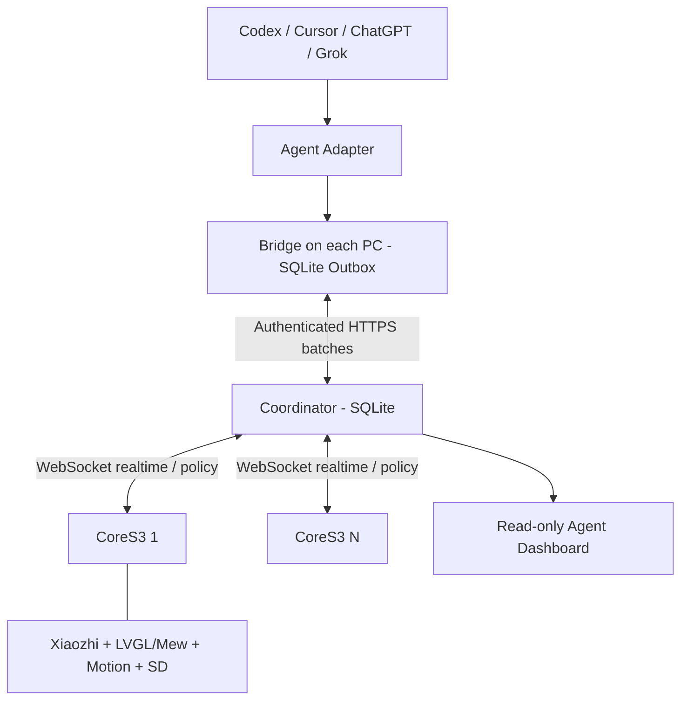

# 02｜架構、部署、網路與故障設計

## 1. 部署拓樸

Bridge 與 Coordinator 不共享 SQLite 檔案；Coordinator 接受多 Bridge 同步。Bridge 部署於使用 Agent 的每台 Windows/macOS/Linux 電腦。Coordinator 原生／Docker／NAS 三型可選，從區域網路起步、可 VPN／授權中繼；CoreS3 永不直接暴露 Internet。mDNS 發現＋人工手動 IP 備援；首次配對需顯式授權。

## 2. 模組與唯一責任

| 模組 | 擁有資料／控制 | 不可做的事 |
|---|---|---|
| Adapter | 原始觀測證據、能力說明 | 偽造 Agent 原生 ID／未經授權讀私密資料 |
| Bridge | 本機觀測、來源編號、Outbox、重試 | Coordinator 離線時直推 Agent 通知給 CoreS3 |
| Coordinator | 全域政策、事件索引、派送、已讀、裝置配對 | 自行修改來源事件或操控遠端 Agent |
| CoreS3 Transport | 安全連線與臨時命令 | 直接操作 LVGL／AudioCodec／Servo |
| NotificationController | 權限、TTL、狀態機、Generation | 直接做耗時磁碟／網路等待 |
| ResourceArbiter | 通知對 UI/Audio/Motion 的授權 | 取代 Xiaozhi 原廠音訊最高控制權 |
| Presenter | 受控更新 Mew UI／Audio／Servo | 持久化通知歷史 |

## 3. 失敗模式

**Coordinator 離線**：裝置即刻撤銷所有 Agent 通知呈現權限（受失聯偵測上界限制）、清除通知文字及通知音訊／動畫；保留非通知 Mew 待機與 Xiaozhi。Bridge 繼續本機收集、Outbox；不經 Bridge 備援直送。Coordinator 重連後須完成身份／政策版本／撤銷／穩定門檻，方可 ACTIVE。

**Xiaozhi 開始對話**：不是安全撤銷來源、而是優先資源搶占；通知音訊／動畫讓出資源，事件留待 Coordinator 重新評估；Xiaozhi 結束時需重新檢查 TTL、隱私與最新狀態。

**多裝置**：全域已讀由 Coordinator 管，A 呈現不代表 B 呈現；每個裝置獨立 ACK，重送僅冪等。

**資料對帳**：Bridge `(bridge_id, epoch, bridge_sequence)` 表示本地追加式觀測順序，不保證來源因果順序。連續 ACK 游標不得跳過缺口；跨 Bridge 時鐘不可直接 Last-Write-Wins。矛盾證據標記 Unknown／Conflict，仍保留原始事件。

## 4. 狀態機

服務狀態：`ACTIVE`、`SUSPENDED`、`RECOVERING`、`ERROR`。SUSPENDED／RECOVERING／ERROR 都不得呈現 Agent 通知；錯誤狀態可執行有限退避重試，不可繞過權限。`ACTIVE→SUSPENDED` 優先於清理 ACK，`RECOVERING→ACTIVE` 須檢查驗證及穩定性門檻。重試有指數退避與 jitter；參數待量測。

## 5. 信任邊界

Bridge→Coordinator、CoreS3→Coordinator、Dashboard→Coordinator、Bridge Local GUI 均為不同授權主體。只使用短期或可撤銷憑證；裝置身份與政策版本分離；任何遠端來源都不得要求 CoreS3 任意讀 SD 路徑、執行腳本、控制 Servo 角度或覆寫原廠設定。動畫僅用預先白名單化的聲明式時間軸，授權素材載入並套用物理限制。
